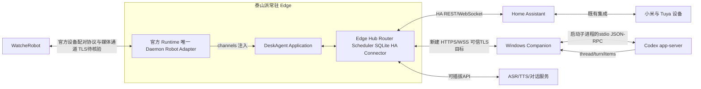

# Desk Agent R1 产品设计 V2.0（草案）

> 状态：待硬件事实补充、待用户决策；本文是产品与技术设计建议，不代表用户已批准全部假设。版本日期：2026-10-11。

## 1. 产品定位与设计原则

Desk Agent R1 是一个以桌面机器人为交互身体、以家庭边缘主机为常驻业务中枢、以 Windows 上的 Codex Companion 为开发任务入口、以 Home Assistant（HA）为家居设备唯一执行与状态来源的个人助手。用户可以通过机器人直接说话发起 Codex 任务并听取播报；也能用自然语言查看、控制已纳入 HA 的小米与 Tuya 设备，并使用提醒、闹钟、备忘录、陪伴与桌面快捷操作。

首个建议交付切片是单用户家庭自用的完整纵向体验：一台待确认型号的 WatcheRobot、一台 Windows 电脑、一台跑 HA 的泰山派。该范围是设计建议，尚未取得用户确认；产品化销售、多人家庭权限、远程访问和规模化部署均不视为首版默认范围。

设计原则：

1. **用户说出目标，系统先理解再执行。** 高影响或对象不明确的动作先澄清；HA 返回服务调用成功只代表请求被接受，不能代替设备状态证据。
2. **每项能力都有真实责任方。** HA 管家居实体、状态与服务；Edge Hub 管任务路由、日程、持久数据、通知策略；机器人负责传感器和面对用户的音频、屏幕、表情与动作；Windows Companion 负责 Codex app-server 本地连接与授权。
3. **状态清楚、失败可解释。** 用户能知道正在听、在理解、在等待 Codex、等待确认、执行失败或完成。系统不能把“已发送”说成“已完成”，不能假装断网时仍能访问 HA 或 Codex。
4. **陪伴有边界。** 情绪表达是交互风格，不是心理诊断；记忆须可查看、可删除，只有用户同意后才保存偏好；避免将设备控制、提醒或 Codex 输出包装成事实之外的承诺。
5. **先由硬件事实定体验边界。** 官方 WatcheRobot Python SDK 已核验可提供多类设备控制能力，但泰山派部署、音频/表情资源和具体屏幕能力仍待PoC；云台角度、紧停、供电、RTC等均待板级资料或实测。任何未过验证门槛的能力都标为规划项。

## 2. 一天中的完整使用故事

早晨，Edge Hub 在线且局域网可达时，机器人在计划时间播放本地闹钟音效、表情提示；用户通过语音或有界的预装触摸/滚轮映射贪睡或停止。PC 可以关闭，Edge 仍负责调度。Hub 或局域网不可达时不依赖新远程调度，只显示/播报本地可实现的离线状态；恢复后按 `missed_policy` 汇总未响事项，不补发连环铃。断电准点能力取决于实际时钟与供电验证，不先作承诺。

用户问“客厅灯和空调现在怎么样？”机器人把查询交给 Edge Hub，Hub 读取 HA 实体状态并用可观测结果回答，明确列出不可用实体。用户也可照常使用米家、Smart Life 或 HA 自动化；本产品订阅 HA 状态更新以收敛外部变化。用户手动操作与本产品命令冲突时，重新读取并报告真实当前状态，不偷偷重试或强制恢复旧值。复合场景部分成功时逐项说明，不声称原子事务，也不自动撤销危险/不可逆动作。

工作时，用户对机器人说“让 Codex 检查这个工作区的启动失败，先找原因再给我修复方案”。机器人用语音确认任务已提交并显示表情/可用状态反馈；完整任务详情和文字结果由 Edge Web/PC Companion 展示。Windows Companion 启动本机 app-server 子进程，通过 stdio 管道创建或恢复 Codex thread 并转发 turn 事件。若 Codex 需要审批，机器人只在 app-server 实际报告等待审批时提示用户，并展示可理解的请求；授权绑定该请求且过期失效。用户可说“停一下”：系统停止播报/聆听或中断任务的意图必须区分；只有收到终态确认后才播报取消完成。本轮结束时，分别显示运行状态、Codex结果陈述、工具检查（exitCode/产物）和用户验收状态；turn/completed 不是任务验收通过。只有实际检查证据支持时才说“修好了”或“测试全过”。界面标为“待查看”“待回复”或“本轮结束”，用户验收由用户完成。

晚上，用户说“记一下周五买猫粮”，助手确认识别出的时间和内容，写入 Edge Hub 的提醒记录；之后可查询、改期、贪睡或删除。用户也可以随时说“陪我聊会儿”，助手使用选定的人设语气和受控表情；提醒时用产品动作词典播放轻提示。夜间减少动作频率和音量，云台仍须通过R1安全验收后才能启用；通知是否突破勿扰由用户配置。

## 3. 功能范围与场景矩阵

分级含义：P0 为单用户日用核心链路；P1 为需要传感器、算法或长期打磨的增强体验；P2 为可扩展能力。所有场景都依赖具体硬件、服务可用性和验收门槛，等级不等于已实现。

|级别|场景|触发与行为|依赖与边界|
|---|---|---|---|
|P0|唤醒与提问|唤醒词后聆听，反馈录音状态，完成转写与回答|麦克风、唤醒与ASR链路；未经验证不能称免按键可用|
|P0|连续追问|首轮完成后在可配置的20秒窗口内等待续问|窗口可调；超时退出聆听并提示|
|P0|创建Codex任务|口述目标，生成简短确认摘要，再提交到指定桌面会话|Windows Companion 在线且会话已授权|
|P0|选择Codex工作区|从显式配置的工作区列表选择，显示名称与目标|禁止从语音猜测任意路径；首次添加需本机确认|
|P0|Codex进度播报|按关键阶段播报，表情/灯光呈现忙碌状态，短语音播报关键节点|只依据实际 app-server 事件；完整详情在 Edge/PC Companion，不依赖机器人动态文字卡片|
|P0|Codex结果摘要|读取最终完成状态，摘要实际变更和未解决点|结果可用；不把 turn 完成等同代码正确|
|P0|停止播报|停止当前音频输出，保持任务状态不变|机器人本地可用；任务状态在 Edge/PC Companion 显示|
|P0|停止聆听|关闭当前录音窗口，不改变已提交任务|麦克风控制可用|
|P0|取消Codex任务|向正确的 turn 发 interrupt，等终态后确认|Companion 在线；不把本地静音当作任务已取消|
|P0|HA状态查询|查询灯、插座、温度等明确实体当前状态|HA可达且实体可读；注明状态时间或未知|
|P0|控制单一设备|执行明确设备动作并观察 HA 状态变化|实体匹配明确；无反馈时只说请求已发送|
|P0|执行HA场景|调用已配置场景，如离家或观影|HA场景已存在；需用户确认高影响场景|
|P0|复合家居动作|依序调用多个实体/场景，逐项核验并汇总|不具备跨设备原子性；外部操作竞争时读取当前状态并报告，不重试过期命令|
|P0|创建提醒|记录时间、时区、内容和重复规则，必要时读回确认|Edge Hub在线调度；PC可关机；Edge/LAN离线不承诺新调度|
|P0|提醒到期|Edge在线且LAN可达时机器人播放本地音效/短语音并提示表情|基础音效不依赖云TTS；离线恢复按 missed_policy 汇总，不补发连环铃|
|P0|贪睡/停止闹钟|通过语音或有界预装输入映射贪睡/停止，不依赖动态文字卡片|PC可关机；运行时至少Edge、机器人和LAN可达|
|P0|取消/删除提醒|定位具体提醒后软删除并同步 tombstone|Edge权威记录；机器人断线缓存/持久调度需固件扩展，属P1|
|P0|创建闹钟|设置一次性或重复闹钟，回读日期、时间和规则；到点先播本地音效|Hub在线且LAN可达；时钟误差目标需校时健康；断电缓存不是A路线已证实能力|
|P0|创建备忘录|保存用户明确要求记录的文本，返回确认|默认只保存在 Edge Hub；不暗示已写入外部应用|
|P0|查询与修改记录|按日期/关键词查询，先明确目标再修改或删除|模糊匹配时列候选，不擅自覆盖|
|P0|静音与勿扰|默认建议23:00–08:00勿扰，可由用户修改；报警按用户配置的优先级响铃|本地策略持久化；不擅设安全例外|
|P0|情感搭子闲聊|按人设自然对话、追问和轻量鼓励，并联动受控表情/安全微动作；用户可随时切回任务模式|模型/语音供应商可插拔；动作受P0安全 gate；不作心理或健康诊断|
|P0|丰富表情|用至少16种表情呈现聆听、思考、陪伴、提醒和任务状态|使用官方 expressions/presets/works 的实际能力范围；不等于任意UI卡片|
|P0|HA主动通知|可选开启用户选定的 HA 状态事件规则，调用已有HA脚本或提示|默认关闭；复用 Reminder/HA Connector，不作为独立子产品；可观测实体才触发|
|P0|Codex完成/审批通知|任务终结、等待真实审批时提示；用表情、灯光或安全允许的动作反馈|仅据真实 app-server 事件；动作等硬件安全 PoC|
|P0|工作/休息场景|可选内置工作/休息流程（默认关闭）；开启后复用Reminder和已配置HA脚本|日用提醒配置场景，不另建子产品；各步骤分别确认|
|P0|番茄钟与久坐/饮水提醒|可选预设提醒（默认关闭），启动计时后本地提示、可延后/停止|复用Reminder与Scheduler，不另建子产品；不作健康诊断|
|P0|触摸/滚轮快捷回应|触摸或滚轮执行当前设备明确显示/表情对应的有限动作，如暂停闹钟、确认或取消|SDK inputs 提供 backtouch/screentouch/roller 事件；只绑定有限白名单操作|
|P0|事件驱动有限云台动作|唤醒回应、提醒轻提示、Codex完成点头等产品动作词典；通过 MotionDomain 或预制作品执行|动作命名是产品定义；通过机械行程、stop、动作完成反馈、掉线安全 gate 才算R1验收完成。未过时可做静止演示，但完整R1动作项仍未验收|
|P0|情感对话联动表情/动作|用户闲聊时按人设回应并选择受限表情，必要时执行安全微动作|不得由模型任意生成角度；云台动作受硬件安全 gate|
|P1|视觉在场跟随|可选按 device-side face tracking 进行轻微注视响应|需兼容设备、模型与运动安全 PoC；非身份认证；不依赖声源定位|
|P1|离线提醒缓存/自治调度|机器人离线期间本地持久调度，恢复后对账|需新增持久化调度API、时钟校准、重启和删除对账验证；不属于Python SDK已证实能力|
|P1|扩展HA事件场景|洗衣结束、门铃、环境舒适提示等基于现有HA实体规则|内置提醒框架已属P0；扩展传感器实体规则/自动化编排可选，无实体则不启用|
|P1|日历、天气、每日简报|从明确授权且配置的真实数据源汇总并播报|须选定数据源与云隐私范围；无数据就不编造|
|P1|自定义动态 UI 卡片|任务详情、提醒列表、可操作的文字卡片|公开 Python SDK 没有任意卡片渲染证据；需受控固件扩展。若用户要求首版必须有则转嵌入式/协议扩展 PoC|
|P1|语音供应商切换|按配置选择本地/云端 ASR、TTS 或模型|Tuya AI或其他服务仅作可插拔候选，能力和数据处理另验|
|P2|多人家庭|区分成员权限、个性偏好和私人提醒|身份认证、声纹准确性、权限模型另行设计|
|P2|跨设备同步|将记录同步到手机或外部日历/任务服务|需分别评估授权、冲突与数据删除策略|
|P2|远程访问|在家庭网络外查看状态或发起任务|需安全接入、身份认证和远程访问威胁评估|

## 4. 语音交互与任务路由

**建议主路径：** 唤醒 → 短提示音/表情表示聆听 → 语音采集 → ASR 转写 → 意图和对象解析 → 必要时澄清 → 用户确认（高影响动作）→ 路由到 Codex、HA 或 Edge Hub 功能 → 等待真实结果 → 语音简答与屏幕详情 → 可选续聊。首轮回复后建议开放20秒续聊窗口，需结合误触发、噪声与待机功耗实测后定值。

“直接讲话”需明确是唤醒词免按键、按键/PTT，还是始终监听。无唤醒词直说只有在硬件和声学 PoC 通过后才能写入产品承诺；PTT 可作为初期调试及故障回退。用户提出的“直接讲话对话送给Codex”也要区分现有 Codex 桌面活跃会话与机器人创建/选择的 Codex thread。产品建议先从显式选定 Windows Companion 工作区和任务线程开始；任意桌面聊天双向接管能力必须先通过跨进程 PoC。

语音解析规则：保留用户原意，不擅自重写任务目标；提交前用一句话回读高歧义或高影响内容。未明确工作区、目标对象、时间或动作时先问一个最关键问题。多个任务并行时，不串播 thread 与 turn：后台始终以 bridge_task_id 关联 thread_id、turn_id、workspace_id、occurrence_id。一个 workspace 建议默认单写任务，其余排队；多 workspace 并行需用户选择和明确显示，不把“3个 workspace”写成产品硬上限。

取消语义拆成三项：停止扬声器播放、停止当前麦克风采集、取消正在执行的任务。一个“停”指令应依据当下状态确认目标，若可能影响任务则短问澄清。中断请求成功不代表任务已进入终态；只有收到 turn/completed 并检查最终 status 后，才能报告取消、失败或完成。

## 5. 家居、提醒与个人记录

HA 是**本产品内部**家居控制的唯一入口和状态源；用户仍可照常操作米家、Smart Life 与 HA 自动化。Edge 订阅 HA 状态更新以收敛本产品之外的变化。Tuya 设备控制优先走已有 HA 集成。TuyaOpen/TClaw 可作为独立 AI/skills PoC 服务，只有确认功能有价值、服务端/LAN工具 callback 有认证、权限边界清楚后再接入；不强制把 Tuya 能力移植进 ESP32，也不假设账号权限自动覆盖全部API。外部用户操作与产品命令竞争时重新读取 HA 状态，报告当前真实状态，不偷偷重试、不强制恢复旧值、不重放过期命令。复合场景按步骤收集状态；部分失败时逐项说明，不自动撤销危险或不可逆动作。HA `call_service` 成功仅表示请求已提交；没有状态反馈时只说“已发送/无法确认”。

Edge Hub 是提醒、闹钟、备忘录和偏好配置的权威存储。P0 定义为 Edge Hub 在线且机器人与Hub的局域网连接可达时的调度体验；PC关闭不影响Edge调度和提醒。Edge 或 LAN 不可达时停止依赖新调度，仅展示设备本地可实现的状态。恢复后按 `missed_policy` 对未响事项作简短汇总或显示，不补发连环铃。默认不把发生项缓存或自治调度能力归给机器人 Python Runtime。机器人离线24小时缓存/本地自治调度为P1固件扩展，必须补持久化调度API、时钟校准、重启恢复、删除/贪睡对账和漏报策略后才能承诺。

时间记录采用显式时区；重复规则保存本地日历语义，夏令时处理须定义。桌面用户可以查看、改期、跳过、贪睡和删除，并可查询修改记录。建议默认勿扰23:00–08:00，用户可改；报警按用户设置的类别和优先级处理。相同事件30秒内合并、相同来源事件5分钟冷却；用户配置的闹钟优先于普通通知。提醒本地准点目标只适用于校时健康、Edge在线及机器人/局域网链路可用情形；断连恢复按 missed_policy 汇总不补连环铃。Hub 数据库采用事务写入，备份与恢复机制、磁盘满策略和损坏处理需实现阶段定义。原始音频和凭据不纳入普通备份；提供单独删除路径。

建议最小数据模型：Reminder 含 `id, text, due_at, timezone, recurrence, status, version, created_at, updated_at`；每次触发 occurrence 有 `occurrence_id, reminder_id, scheduled_at, state, snooze_until, version`。Note 含 `id, text, tags, created_at, updated_at, deleted_at`，默认无跨服务同步。Task 含 `bridge_task_id, source, workspace_id, thread_id, turn_id, goal_text, state, created_at, updated_at, last_event_seq, result_summary_ref`。敏感内容不进事件日志；删除用 tombstone 同步，凭据与长期偏好不混在任务表中。

Edge 与 Companion/Robot Adapter 的消息 envelope 建议包含 `protocol_version, request_id, session_id, workspace_id, thread_id, turn_id, issued_at, expires_at, event_seq, kind, payload`；字段依消息类型必填。写请求先回 `accepted`（被接收）再回 `completed/failed/cancelled`（实际终态），不得把 accepted 当执行完成。对重复 request_id 幂等；event_seq 用于断线去重与缺口发现；重启后从各真实服务核对状态并 reconcile。负载只允许声明式 JSON action，不接受语音生成任意shell命令。Edge-PC 配对使用短有效期一次 PIN 并由两端确认，签发可撤销凭据并支持轮换；新链路以可信 TLS 为开发目标，证书校验不允许跳过。Robot 与 Runtime 的设备配对使用 SDK 原有六位码流程，媒体/设备通道是否有 TLS 或等效加密待核验；不得把新链路 WSS 方案说成原生设备链路已加密。

|权限类别|执行范围|确认规则|
|---|---|---|
|Codex任务|在用户明确选择且已配置的工作区内运行；工具行为遵循 app-server 实际审批策略|越出工作区、破坏性操作、发布/推送等需要PC上具体确认。机器人只提示待确认；任意一句“同意”不是通用授权|
|家居控制|由Edge按实体/服务 allowlist 和用户已配置范围调用HA|未纳入范围、目标不明或状态冲突时先澄清/重新读取状态；不越权扩展范围|
|提醒与个人记录|按当前用户显式请求管理Edge内记录|修改/删除必须指向明确记录；模糊时先列候选|

此表是产品权限建议，不代表已经实现，也不替代用户当前环境的授权设置。

发布安全门槛：如果 Robot 原生配对/媒体通道没有 TLS 或等效保护，A路线仅可在显式受信且隔离的家庭LAN做PoC，不视作传输加密完成或生产R1通过。生产R1要求厂商提供兼容安全通道，或采用受控固件/协议扩展；不能只把 raw WebSocket URL 改成 WSS。HA 原令牌由 Edge 端专用账户和 entity/service allowlist 收窄，不宣称 HA token 自带实体级scope；机器人不获取该原令牌。

情感陪伴默认不长期记忆私人信息。拟记忆偏好（称呼、语速、音量、表情偏好）先征得同意，提供查看、编辑、清除入口。不得通过摄像头判断用户心情或健康状况。表情只是表达助手交互状态，不能替代服务结果、审批状态或安全告警。

## 6. 表情、动作、声音和屏幕

建议将表情表达与业务状态机分开：业务状态唯一且可审计；动画只是表现层。首版至少设计16种可组合表情：待机、好奇、聆听、思考、理解、开心、温和鼓励、专注、任务排队、任务执行、等待审批、提醒、闹钟、困惑/澄清、成功、部分成功、失败/离线、勿扰（可合并或拆分为18项）。使用 SDK 受控的 gaze_x/y、眼睑、auto_blink、love/question tag、风格和 expression preset/works 组合眼神、眨眼、歪头与不同陪伴人设；不需要常开相机。支持范围以真实 firmware capability 为准。若 `expression.audio_follow.v1` 可用且确认动态 PCM 的播放时钟联动，可启用说话嘴形随播报；首版验收不过则使用普通 speaking 动画，不承诺音素级口型同步。

声音与运动应由单一仲裁器管理。建议优先级：硬件紧停/安全告警 > 用户明确语音交互 > 用户配置的闹钟 > 等待审批/其他高优先提醒 > 普通任务状态 > 情绪动画。SDK 源码提供有限 `play_pcm` 与 `stop()` API（设备需支持 `audio.stream`）；TTS 先合成一条短句为 24 kHz mono s16le PCM，再播放，不承诺边合成边逐token流播。单段播报建议5–10秒以内，避免长缓冲和过高延迟；具体分段由语义确定。每次状态只由一个 owner 控制扬声器、云台和表情；stop/抢占后等待设备状态并释放资源。

运动只通过产品动作词典触发（例如轻点头、提醒轻提示、休息姿态），自然语言模型不能直接生成 pan/tilt 数值。官方 SDK 有 `move_to(pan_deg, tilt_deg, duration_ms, profile)` / stop 命令模型，但不代表已知物理行程、安全限位或掉电行为。云台是用户要求的P0能力；动作须通过机械行程、stop、完成反馈、掉线安全 gate。未过时可以演示静止表情，但R1完整验收不能悄悄把动作改成P1。具体角度、速度、冷却和紧停由实施者按官方板级资料与实测确定。

官方 Python SDK 有表情渲染与触摸/滚轮输入事件能力，但没有任意文字卡片或 HTML UI 渲染证据。首版机器人屏幕承担表情、简短状态表达和快捷触摸反馈；Edge Web/Windows Companion 承载任务详情、提醒列表和可滚动文字。screentouch/backtouch/roller 用于绑定清晰的有限操作，例如暂停闹钟、确认或滚动，不要求SDK渲染卡片。动态UI卡片、波形和倒计时界面列为 P1 固件/协议扩展；若用户把它定为首版硬需求，应切换到受控嵌入式/协议适配并重新估算。SDK内部 vector canvas 坐标或 face-tracking preview 尺寸都不能推断实际屏幕分辨率。

## 7. 系统架构与数据边界

|组件|主要责任|接口与数据|凭据边界|
|---|---|---|---|
|Robot Adapter / 官方 Runtime + 唯一 Daemon|把产品命令映射到官方设备 channels，接收实际完成与输入事件|DeskAgent Application 只经 Daemon channels；Robot↔Runtime 使用官方设备配对协议/媒体通道，TLS待核验|不保存 Codex 或 HA 凭据|
|Edge Hub|会话路由、Scheduler、SQLite、HA Connector、通知策略、人设配置|Robot Adapter channels；HA REST/WebSocket；与 Windows Companion 的新建 HTTPS/WSS 链路（可信TLS目标）|HA token 只在 Hub 受保护存储；专用HA账户与 entity/service allowlist 是产品策略，不宣称令牌自带实体级scope|
|Home Assistant|实体、设备、场景/脚本、设备状态和控制服务|原生 REST API、WebSocket API、现有设备集成|独立受限令牌；不得把 token 写入固件或语音日志|
|Windows Companion|本机用户授权、工作区选择、Codex事件转发|Companion 启动本机 app-server 子进程，通过 stdio JSON-RPC 管道连接；与 Edge Hub 建立鉴权的可信 TLS 会话|Codex 本机授权留在 Windows 用户边界；Hub 不能绕过桌面权限|
|Codex app-server|thread/turn/item 生命周期和工具审批请求|JSON-RPC over stdio；实验性 TCP/WebSocket 不作为 LAN 接口|不直接暴露 app-server 到局域网|
|ASR/TTS/对话供应商|可插拔语音转写、播报或模型回答|待供应商选型与数据处理评估；Python SDK 本身不拥有官方 default application 的 ASR/LLM/TTS 业务逻辑|最小化发送内容；由用户选择启用和云处理范围|

app-server 使用 initialize/initialized 建立协议会话；thread/start、thread/resume、thread/read、thread/list 管理 thread；turn/start、turn/steer、turn/interrupt 管理 turn；以 turn/completed 的最终 status 和 item/completed 的真实项目事件解释运行过程；turn/completed 只表示本轮终结，不等于用户任务验收通过。thread/read 不是事件订阅；一个进程加载的 thread 状态不证明另一个 Codex 桌面应用的活跃会话可被共享或控制。stdio 是 Companion 启动本机 app-server 子进程的管道；不直接暴露 app-server 到 LAN。Bridge 的 task id 与 thread/turn id 分离并持久化；重连后核对真实状态，处理幂等和重复事件。审批必须关联到 app-server 实际请求，等待审批才提示；重启或过期的审批不能自动同意。

HA WebSocket 提供 get_states、call_service、subscribe_events（包括 state_changed）等能力；REST API 可用于受支持操作。服务调用成功回执不是设备物理成功，须根据状态或反馈确认；没有可观察状态时只能报告已发送。Tuya HA 集成可能依赖云推送，且部分能力可能未暴露；小米 HA 集成取决于所选集成、账号地区以及云/中枢/LAN 路径，不能对所有小米设备推定为本地轮询。泰山派本地语音算力、网络拓扑与 HA 部署形态不预设。

## 8. 部署、安全与故障体验

部署前通过首配流程识别 HA OS、Container、VM 或其他形态；不得假定 HA Add-on 可用，也不得把 Hub 安装进 HA Core 运行环境。Edge Hub 容器或系统服务方案待泰山派 OS、CPU 架构、磁盘、容器支持和运维方式确认后决策。用户在向导中填写或选择当前 HA 地址，创建专用账户/令牌并配对机器人；令牌只保存在 Hub 受保护存储，不下发到机器人。

数据按用途分开保存：任务元数据、提醒/备忘录、偏好、设备令牌、语音临时缓冲和审计事件有不同保留策略。日志默认不保留原始音频、不记录完整敏感备忘录或凭据；提供诊断导出时先脱敏。语音云处理、相机、远程访问、多人声纹识别均为独立开关和后续决定。首版相机默认关闭；presence/face tracking 如后续启用只作可选在场交互，不用于身份认证或情绪判断。

故障响应按链路分别呈现：PC 断连时 HA 和 Edge调度提醒继续工作；Codex任务等待 Companion 恢复并对账。Edge或Robot-LAN不可达时，停止依赖新调度，提供设备可实现的状态反馈；恢复后按 missed_policy 汇总未响提醒，不补发连环铃。HA断连时保留任务和提醒但不发送过期家居命令。HA外部用户/自动化状态变化由订阅收敛；本产品命令与外部动作竞争时重新读取当前状态并如实报告，不自动重试或恢复旧值。WAN断连时按实际部署判断本地HA/语音能力；机器人断电时不假设有RTC/备用供电。Python Runtime不被视作24小时本地提醒缓存。机器人离线自治调度仅属P1固件扩展，须通过持久化、校时、重启和删除对账gate。

OTA 与运动安全需设硬件门槛：校验目标板、分区、启动回滚能力、电量/供电稳定、恢复模式；升级期间禁用云台动作，失败可恢复。运动控制要有硬件紧停、行程限位和安全状态验证。若主板或 SDK 无法提供这些保障，先限用/关闭云台动作，不以软件动画代替硬件安全。

## 9. 技术路线选择与决策

**逻辑架构先确定为 Edge Hub + Windows Companion + HA Connector + 可替换 Robot Adapter。** 官方 Python SDK README 支持 Python 3.10–3.12、Windows/macOS 首次 BLE 配网，之后Runtime六位码设备配对；`watcherobot app run` 由唯一 Daemon 向 Application 注入 channels。Application 不自行连设备 WebSocket。源码有 `play_pcm` 与 `stop()`；设备需开放 `audio.stream`，有限PCM流有 begin 元信息/SHA256 和 COMPLETED/FAILED/CANCELLED 终态。首版可由外部TTS合成短句PCM后播放；不承诺逐token边合成边播。表达式、触摸和滚轮输入可用范围受设备capability限制。Python SDK没有任意文字卡片渲染接口证据，首版详情放Edge Web/PC Companion。

|路线|用途|优势|风险与决策门槛|
|---|---|---|---|
|A. 兼容固件 + 官方 Python SDK Runtime（首选）|在泰山派常驻Edge内运行Application，经唯一Daemon channels及官方设备配对/媒体通道驱动机器人|已核对有限PCM播放/停止、表情和触摸/滚轮能力，能承载首版日用语音陪伴|泰山派/Linux ARM Runtime、audio.stream/stop实际设备表现、机械动作完成/安全、原生媒体通道加密仍待PoC|
|B. 受控固件/协议扩展|若A无法常驻、设备通道安全不满足生产门槛，或用户把自定义设备UI列为首版必须，则评估嵌入式SDK/协议扩展|补充常驻Adapter、安全通道或动态UI等缺口|嵌入式SDK为开发预览，IDF 6.0.2，工程Flash配置16MB；版本需锁定，安全/动作/音频/显示仍需目标板验收|

动态UI卡片为P1，不是A路线或R1首版门槛；若用户选择提升为首版必须，才进入B的UI适配评估。云台动作是P0，动作完成反馈、机械行程、stop和断线安全必须验收通过；不得因PoC失败而把R1动作项静默降为P1。Robot原生通道若无TLS/等效加密，A仅可在受信隔离家庭LAN演示，不称生产加密完成；R1需厂商兼容支持或B受控扩展。不能只把WebSocket URL改成WSS。Python没有完整Linux ARM支持矩阵，Windows-only Runtime不满足PC关机后常驻陪伴。PoC前记录并锁定 Python SDK commit、Robot固件、STM32/Himax固件版本及Codex app-server实际schema；源码常数只说明API限制，不代表本项目运行容量。嵌入式SDK已有构建/host tests和部分JPEG/PCM、STM32 HIL记录，但不足以证明整机稳定、机械行程、音质或长稳。
## 10. 建议验收目标与分阶段交付

以下数字均为**建议目标，须用实测校准**，不是已有结果：

|时延目标|量化建议|测量起止点与条件|
|---|---|---|
|首个语音反馈|用户说完至“已听到/正在处理”指示 P95 ≤1秒|端点检测结束至设备提示音/表情状态实际显示；本地网络稳定|
|云语义响应|识别请求提交至首个可理解回答 P95 ≤5秒|分别记录ASR、模型和合成语音阶段，按云服务/网络情况分层|
|短句播报|PCM播放请求提交至首声 P95 ≤3秒|TTS短句合成时间与设备播放启动分开记录；≤5–10秒短句|
|HA状态查询|明确实体查询至可观测结果 P95 ≤3秒|局域网健康、实体已有状态且HA在线；超时回报未知|
|闹钟误差|校时健康且机器人在线时相对计划时刻 ±2秒|记录计划发生时间、实际本地音效首声与设备时钟偏差；断电/失联单独报告|

|验收项|建议目标与测量定义|证据方式|
|---|---|---|
|固定语料语义|30条固定验收语料覆盖 Codex、HA、提醒、歧义和否定；关键字段精确匹配率目标≥95%，高风险动作误执行为0|30条仅作冒烟验收，不足以代表统计能力；另建至少200条未见验证语料并按意图/实体/时间字段分别报准确率|
|P0云台动作|覆盖唤醒回应、提醒轻提示、任务完成点头等动作词典|逐动作测行程边界、stop到静止时延、真实完成反馈、断链/重启安全状态；任何一项失败则R1动作验收未通过|
|P0日常场景|至少通过一个工作/休息预设场景、一次触摸闹钟贪睡/停止、一次情感对话与表情/安全动作联动|记录触发、实际动作/状态、停止与恢复；工作/休息和扩展提醒默认关闭，用户开启后复用通用能力|
|P0 HA事件通知|使用一个现有可观测HA传感器规则覆盖正触发、负触发和重复去重|验证HA用户/自动化外部状态更新、本产品通知和30秒合并/5分钟冷却规则；默认关闭，用户选择开启|
|唤醒体验|先定义安静/电视/多人噪声环境；误唤醒目标和漏唤醒目标由 PoC 得出后锁定|在明确授权下统计误唤醒/小时与漏唤醒次数；原始音频不默认留存|
|交互延迟|从用户语音结束到首个可理解反馈；从请求提交到状态确认分别计时，按本地/云链路分位统计|带时间戳事件日志；公布 P50/P95 和网络条件|
|提醒可靠性|在线提醒按计划到期；断连恢复去重；贪睡、删除和重复规则准确|固定时区测试矩阵、掉线/重启注入，核对 occurrence_id/version|
|HA控制|只对可观测实体验证状态收敛；无反馈实体使用“已发送”措辞|保存服务回执、state_changed 与最终读取状态，不把回执当成功|
|Codex任务|覆盖新建/恢复、排队、澄清、审批、steer、interrupt、重连和终态播报|app-server事件与Bridge记录关联；跨桌面活跃会话 PoC 单独判定|
|P0云台动作|至少测唤醒回应、提醒轻提示、Codex完成点头三个动作词典项|逐项测机械行程、stop、完成反馈和掉线安全；未过则明确标记R1动作验收未完成|
|P0工作/休息及触摸闹钟|跑通一个可选工作/休息场景；触摸或滚轮完成一次贪睡与一次停止|确认预装有界输入映射、状态回执、去重及PC关机时Edge仍可调度|
|P0陪伴联动|至少一轮情感对话联动表情，并验证受安全gate保护的微动作及stop|记录意图、表情/动作命令、实际完成或拒绝原因；不采集摄像头推断情绪|
|P0 HA事件通知|一个已有可观测传感器规则覆盖正触发、负触发和重复事件去重|默认规则关闭；由用户启用后验证状态订阅、Reminder复用、30秒合并及5分钟冷却|
|持续运行|建议至少72小时家庭环境运行；内存、磁盘、连接与重复通知稳定|周期性资源采样、错误日志和恢复次数；异常不得靠人工清库掩盖|
|资源余量|稳定场景下关键内存池/磁盘预留目标≥20%，需先确定目标平台和预算口径|在锁定的SDK与固件版本上按实际内存池/磁盘容量测高水位；SDK源码常数不作为项目容量|
|断线矩阵|分别拔除 PC、Edge、HA、WAN、机器人电源，验证恢复与禁止重放策略|故障注入记录、用户可见提示、恢复后的状态对账|

阶段建议采用纵向切片：

1. **配置与决策门：** 实施者核验目标板、屏幕/音频/云台/存储/供电资料及泰山派部署能力；明确用户范围、Codex会话定义、唤醒方式与语音供应商；运行路线A PoC，动态卡片需求决定是否进入路线B。
2. **本地骨架：** Edge Hub 配置、鉴权、SQLite、机器人状态面板与Windows Companion配对；不触发真实控制。
3. **语音到Codex：** 单用户单工作区、清晰任务确认、进度/最终状态播报、审批、取消与断线恢复；先过会话互通 PoC。
4. **HA闭环：** 状态查询、单实体控制、预配置场景、状态核验、部分成功与过期控制处理。
5. **日用个人功能：** 提醒、闹钟、备忘录、勿扰、去重同步、重启恢复和可删除偏好。
6. **表情与动作：** 先做表情和声音仲裁，再在紧停、限位与行程测试过关后启用云台。
7. **家庭试运行：** 按验收表采集结果和已知限制，再决定是否扩大多人、远程和商品化范围。

本文不承诺工期、成本、售价或全量上线日期；这些取决于硬件资料、SDK可用性、接口PoC、部署形态和用户决策。

## 11. 待确认与待验证项

以下五项需要用户决策；文档建议用于推进设计，不代表用户已同意：

|优先级|待决问题|建议默认|影响|
|---|---|---|---|
|1|首版是个人自用还是商品化？|先按单用户家庭自用设计|改变权限、数据保留、安装和支持目标|
|2|Codex请求是进入当前桌面活跃会话，还是创建/选择一个受控 thread？|先让用户显式选择 Companion 中的工作区和 thread|任意活跃桌面会话互通须先过跨进程PoC|
|3|“直接讲话”具体指唤醒词、按键/PTT还是免唤醒常听？|先验证唤醒词，PTT作为设置/调试回退|决定隐私提示、误唤醒和拾音验收|
|4|语音识别/合成/闲聊使用哪种本地或云端服务？是否允许语音发到云端、偏好本地还是云端，以及响应速度/费用取舍？|先做可替换接口和隐私开关，再以PoC比较|影响延迟、离线体验、语音云端使用范围和费用，不预设 Tuya AI 必需|
|5|机器人屏幕动态文字卡片/提醒列表是否必须首版具备？|首版由机器人提供表情、短语音、触摸/滚轮；详情放 Edge/PC Companion，动态UI列P1|若卡片必须首版提供，需转受控固件/协议扩展评估|

实施者负责核验的技术门槛（不是用户提交日志的前置条件）：

- 泰山派/Linux ARM 上 Python Runtime/Daemon 常驻、配对、channels 和重连；Windows-only 不满足电脑关机后仍陪伴的产品目标。
- 目标机器人是否提供 `audio.stream`，动态短句PCM播放/stop/完成态及 `expression.audio_follow.v1`；失败可使用普通 speaking 动画或切换受控 Adapter。
- 设备表达式/触摸/滚轮事件与当前 firmware capability；设备屏幕分辨率、中文可读性、机械 pan/tilt 行程、紧停/限位、RTC/断电恢复、音频拾音与内存余量。
- HA 安装方式、已配置的设备集成、实体可观测性与网络可达性通过首配流程核验；只读取用户明确提供的现行配置，不复用历史凭据。
- app-server 独立进程的 thread/turn 事件、审批、取消、重连 PoC；Codex turn终态与用户任务验收分层呈现。

## 12. 草案结论

当前可确定的是产品责任划分建议、核心用户流程、故障边界、Codex/HA官方接口能力和 WatcheRobot Python SDK 的有限播放、表情和输入能力。逻辑架构建议为 Edge Hub + Windows Companion + HA Connector + 可替换 Robot Adapter；首版机器人以丰富表情、短句语音、触摸/滚轮回应为核心，任务详情在 Edge/PC Companion。首版动态卡片和常驻 Runtime 支持均受PoC约束。五项用户选择、现场设备实测和 Adapter 路线仍待确认；本设计不等同批准或验收通过。
