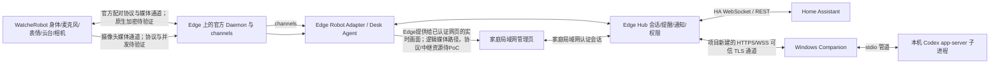

# Desk Agent R1 产品设计 V2.1（用户体验草案）

> 文档目的：从每天实际使用的角度描述首版产品。本文不是实施完成报告，也不表示用户已经批准所有产品经理建议。
>
> 标记说明：**已确认需求**来自用户明确描述；**产品经理建议**是为形成连贯首版而选择的合理默认；**技术待验证**需要官方接口、目标设备或现场PoC确认。

## 1. 产品目标

Desk Agent R1 是一个在家里常驻的桌面助手。用户面对 WatcheRobot 说话，能发起 Codex 工作、查看和控制已经接入 Home Assistant（HA）的家居设备，也能管理提醒、闹钟和备忘录，与机器人闲聊并通过表情和有限云台动作获得自然反馈。用户在本地管理页面查看任务、通知、家庭状态与摄像头实时画面。

用户明确希望首版覆盖的体验包括：直接讲话对话并把任务交给 Codex、任务完成后播报；已有小米和 Tuya 设备由 HA 集成；HA 运行在泰山派；机器人有丰富表情、有限云台动作、提醒、闹钟、备忘录、情感陪伴；新增摄像头只能在家庭局域网实时查看，不做录像、回放或远程查看。摄像头不采集监控音频、实时传输活动提示灯/状态、基础文字卡片列为产品经理建议与产品目标，尚非已确认的硬件能力。

产品经理建议首版按单用户家庭自用设计，以唤醒词开始、20秒内连续追问、PTT作为回退；采用 Edge Hub 常驻、PC Companion 连接 Codex 的方式。机器人以表情为主，基本文字卡片（时间、聆听、任务状态、倒计时、隐私状态）仍作为P0产品目标；若现有SDK不能承载，必须通过固件扩展完成，不能悄悄降为P1。以上默认用于推进讨论，待用户确认。

成功标准是：用户在不打开电脑操作界面的情况下能自然说出任务或家居目标，知道系统正在做什么，必要时能打断、纠错或授权；Edge在线时日常提醒和家居通知可用；任务结果、设备状态和摄像头是否正在传输都能被清楚识别。失败表现包括：把请求发错Codex项目或家居设备、把“请求已发送”说成“已完成”、离线后重放旧指令、通知连续轰炸、把待确认操作误当已授权、摄像头关闭后仍传输、把未验证的设备能力包装成已实现。

## 2. 一天中的使用旅程

**起床。** Edge Hub 和机器人局域网连接正常，闹钟按用户设定播放本地声音。机器人用表情和基础提醒卡片提示“闹钟”；用户触摸或滚轮贪睡十分钟，系统更新闹钟 occurrence 并给出确认。贪睡只延后提醒，不代表事项完成。电脑可以关闭，Edge仍能调度。Edge或局域网不可达时，机器人不假装收到新日程；恢复后按 `missed_policy` 汇总错过的事项，不补发一串闹铃。机器人断线自治提醒不属于首版已确认的SDK能力。

**开始一天。** 用户说“开始工作”，机器人用状态表情确认。可选的工作/休息流程默认关闭；用户启用后，它复用提醒和已配置的HA脚本。它不是独立的番茄钟、健康或自动化子产品。用户可说“每四十分钟提醒我站起来”，到时可以稍后、忽略或完成这次提醒。

**安排Codex任务。** 用户说“让 Codex 检查 DeskAgent 的启动失败，先找原因，修复前告诉我方案”。助手先识别项目昵称和当前焦点；若只有一个默认项目且目标清楚，回读简短摘要后提交。若项目不明、要修改的范围不清楚，先问一个具体问题。电脑离线时可把请求保存在“待提交”，电脑恢复后提示用户继续；不会自行重放旧任务。任务完成后播报摘要，完整文字、变更文件和检查状态显示在本地任务页面或PC Companion。Codex本轮结束不代表用户验收通过。

**照看家居。** 用户可以让机器人查询灯、空调或运行预设HA场景。用户仍可照常用米家、Smart Life或HA自动化。本产品从HA读取状态和变化；如果用户手动改动与刚发出的命令竞争，系统重新读当前状态并报告，不抢回旧值、不重试过期指令。用户开启某个传感器通知后，机器人只在规则触发且状态可观测时提示。

**记事和陪伴。** 用户说“记一下周五买猫粮”，系统不把日期当作具体提醒时间，而是询问具体时刻；“记一下”没有日期和时间时保存为备忘录。“提醒我”没有时间时先追问，避免悄悄存错类型。只有持久化成功后才说“已保存”；保存失败或离线时明确说“未保存”，不能以本地输入框内容冒充成功。用户说“陪我聊会儿”，助手按选定的人设聊天并配合表情；偏好只有在用户确认后才长期保存，可查看、编辑或删除。

**查看摄像头。** 用户在本地管理页点“实时查看”后，视频流才开启；页面持续显示正在传输（设备活动灯为产品建议，硬件待核验）。关闭隐私开关会立即停止设备侧传输；关闭网页只结束当前查看会话。摄像头不录像、不保存回放、不在家庭网络外查看；不采集或传送监控音频是产品建议。查看期间机器人不为点头或自动跟随抢占云台；关闭查看后释放控制权，不自动跳回先前位置。可考虑在查看页提供手动方向和停止；校准后回中属于产品经理建议，须验证行程与安全后启用。

## 3. 首版功能范围

P0表示完整日用产品的必要体验。技术门槛未通过时应明确标为R1尚未验收，而不是改标P1。P1是可选增强，不是对P0未完成的改名。默认关闭的提醒场景和HA规则复用已有P0能力，不另做独立产品。

|级别|用户能力|日常行为|关键边界|
|---|---|---|---|
|P0|语音对话|唤醒、聆听、回答、20秒内追问；支持纠错和PTT回退|唤醒词、远场质量需设备PoC；麦克风关闭独立于勿扰|
|P0|Codex项目管理|项目昵称、默认项目、受控thread、排队/继续/取消、进度和结果播报|先走独立受控thread；任意当前桌面会话互通需验证|
|P0|Codex待确认与结果|真实审批才提醒；中断后等待终态；本轮结束与用户验收分开|越出工作区、破坏性操作、发布/推送需PC具体确认|
|P0|家居查询与控制|读取HA状态、调用允许范围内设备服务与HA脚本|HA是本产品内部唯一入口；用户可继续用其它App和HA自动化|
|P0|提醒与闹钟|一次性/重复、创建、查询、贪睡、完成、取消、错过摘要|Edge常驻且机器人与Edge局域网可达；电脑可关机|
|P0|备忘录|无时间的“记一下”保存为memo；可查询、改写、删除|与有明确时间的Reminder分开；模糊目标先确认|
|P0|情感陪伴|命名、声音、人设和安静程度可设置；对话联动丰富表情及安全动作|只显式记忆用户同意的偏好；不推测心理或健康状态|
|P0|表情、动作和基本文字卡片|表情表达聆听、思考、提醒、任务状态；云台执行有限动作词典；显示时间/聆听/任务/倒计时/隐私基础卡片|文字卡片是产品目标；SDK若不支持则固件扩展Gate。云台安全未过则整项未验收|
|P0|通知中心|未读、已听到、已查看、稍后处理、清除分别记录|状态互不替代；未读不是未执行，已听到不是已完成|
|P0|摄像头局域网实时查看|用户主动打开才传输，页面显示查看状态，可随时关闭|无录像、回放或远程访问是明确边界；活动灯及不传监控音频为产品建议；视频接口与码率待验证|
|P0|本地管理页|今日、任务、家居、实时查看、设置五个入口|仅本地网络访问，身份认证和配对流程须实现|
|P0|基础断线反馈|显示PC、Edge、HA、机器人、摄像头各自状态|不宣称未知的离线缓存或断电准点能力|
|P1|机器人离线自治提醒|机器人离线时本地持久调度，恢复后合并对账|需固件API、校时、重启、删除/贪睡同步验证|
|P1|视觉在场跟随|用户开启后设备侧face tracking可用于注视/跟随|非身份认证，不判断情绪；看摄像头时暂停自动云台|
|P1|扩展HA传感器规则|洗衣结束、门铃、环境提示等由现有实体触发|只支持已有且有可靠状态的实体|
|P1|日历、天气、每日简报|连接已授权的数据源后汇总|未授权或无数据时不生成猜测内容|
|P1|设备动态卡片拓展|滚动任务详情、列表、复杂交互控件|首版基本卡片为P0；更复杂UI须固件能力评估|
|P2|多人家庭、跨设备同步、远程访问|在首版稳定后另行设计|须重新评估身份、数据和远程安全|

## 4. 语音纠错、焦点与停止

机器人每轮交互有明确焦点：**闲聊/问答、Codex任务、家居控制、提醒/备忘录、摄像头管理**。系统显示和播报当前焦点；正在执行任务时，新话语不能自动改写旧任务。诸如“继续刚才那个”“取消它”必须能唯一解析到 task_id、reminder_id 或控制会话，否则先确认对象。

ASR转写置信不足、时间模糊、项目名相似、家居目标不清时，先读回关键字并允许“改成……”“不是这个项目”“取消”。语音纠错改变待提交内容；已提交任务的修改必须用 steer/新消息并说明它针对哪个任务。家庭控制和闹钟的高影响动作回读目标；普通只读查询和用户预先授权范围内的明确控制不逐条打断确认。

“停”有三种独立含义，系统按照当前焦点执行或简短澄清：

1. **停止播报**：停止当前机器人音频，不改变任务状态。
2. **停止聆听**：结束当前收音，不改变已提交任务；麦克风关闭不等于勿扰。
3. **取消任务**：向正确Codex turn发送interrupt，等待真实终态；不能以静音代替取消。

任务状态至少区分：待提交、排队中、运行中、等待用户输入、等待真实审批、停止中、本轮已结束、失败、用户已验收。PC离线时任务可留在待提交；恢复时明确提示“继续提交”或“删除”，绝不自动重放。`turn/completed`仅表示当前轮结束。界面分列Codex陈述、运行/工具检查及其exitCode/产物、用户验收。只有实际证据支持时才播报“修复完成”或“检查通过”。

## 5. Codex连接方式与项目流程

Codex有三种可考虑的接入方式，定位不同：

|方式|适合用途|与桌面会话的关系|R1判断|
|---|---|---|---|
|[Codex app-server](https://learn.chatgpt.com/docs/app-server)|通过本机协议管理thread/turn、接收事件、审批与中断|Companion可启动本机app-server子进程并通过stdio连接；不能据此推断可接管任意现存桌面聊天|R1首选，授权仍受本机Codex和服务端审批策略约束|
|[Codex SDK](https://learn.chatgpt.com/docs/codex-sdk)|TypeScript/Python代码中更方便地创建和编排Codex任务|封装调用便利不等于桌面活跃会话互通|可用于后续集成评估，不以此承诺接管桌面聊天|
|[Agents API](https://developers.openai.com/api/docs/guides/agents-api/overview/)|构建云端agent服务、工具和新的agent工作流|不是控制用户本机Codex桌面进程的接口|适合独立云端扩展，不是R1桌面Codex控制主路|

本机Codex CLI 0.159.2帮助中能识别app-server命令仅是只读帮助证据，不是app-server联调成功或桌面会话互通证明。

首配时用户在Companion本机选择工作区并登记项目昵称（如“DeskAgent”），可选一个默认项目；机器人语音只选择已登记的昵称，不从口语路径猜任意磁盘位置。首条Codex任务优先创建/选定独立受控thread，并将用户的项目昵称绑定到工作区和thread。多任务在同一workspace默认排队，用户可查看、继续、取消、删除待提交请求；不同workspace并行需明确展示，不串线。

若用户坚持将请求送入当前桌面活跃聊天，先验证该桌面会话的thread标识、事件订阅、审批、转向、中断和重启恢复。任一条件无法验证就清楚提示目前使用受控thread，不假称当前聊天已经接收。app-server协议支持thread/start、resume、read/list及turn/start、steer、interrupt等生命周期；以真实事件描述进度。审批提示绑定实际app-server请求，重启后过期确认不自动同意。

### 权限边界

|操作范围|默认处理|需要确认的情形|
|---|---|---|
|Codex只读查询、已登记工作区内且策略允许的普通操作|按已配置工作区和Codex服务端审批策略执行，不逐项打断|越出工作区、破坏性操作、发布/推送等，由PC Companion展示具体动作并要求确认；机器人只能提示待确认|
|HA家居控制|仅执行Edge配置的实体/服务白名单内请求；状态查询按只读处理|超出实体或服务范围先澄清；高影响动作按用户配置确认|
|提醒、备忘录、偏好|管理当前用户的数据；长期偏好需用户明确同意|删除或改动对象不唯一时确认目标|

“同意”只对当前展示的具体操作有效，不能作为通用授权。触摸、滚轮和语音短答仅能响应当前明确呈现的有限动作，不扩大工作区、家居范围或发布权限。此表是产品权限设计，不能代替用户当前授权，也不表示已实现。

### 主要组件关系

图中的Edge-PC和管理页认证链路是本项目目标；机器人摄像头媒体经官方Daemon与Edge Adapter进入统一认证入口，网页不绕过Daemon直连设备，具体视频协议与中继资源待PoC。机器人到官方Daemon的原生设备通道不能标成HTTPS/WSS，也不能在没有证据时声称已加密。Application经Daemon提供的channels访问设备，不自行建立设备WebSocket。

## 6. 提醒、备忘录、通知与陪伴

### 提醒和备忘录

**Reminder**是“在某时或按重复规则提醒我做事”；**Note**是“保存这条信息以便以后查”。没有日期和时间的“记一下”进入Note；“提醒我”缺时间必须追问；有日期但没有具体时刻（如“周五买猫粮”）时询问时刻，不自行补成零点或任意默认时间。具体日期、时区或重复规则歧义时先读回确认。两者都支持创建、搜索、查询、编辑和删除；Reminder另支持稍后提醒、完成本次、跳过一次、取消整条规则。新增或修改只有持久化成功才向用户确认“已保存”；写入失败、离线或结果未知时明确告知未保存/状态待确认，不把临时输入当作已保存。

闹钟优先级高于普通提醒。闹钟到期播放本地音效，不依赖云端TTS；若能动态语音再补一句播报。用户通过预装的有限触摸/滚轮映射停止或贪睡。停止声音只标记“已听到/已处理本次响铃”，不自动把待办标为完成；用户显式说“完成”或在允许的按钮映射中选择完成，才完成事项。

通知中心把 `unread`（未读）、`heard`（已听到）、`viewed`（已查看）、`snoozed`（稍后）、`completed`（事项已完成）、`dismissed`（清除）分开记录。已听到不等于已查看，已查看不等于已完成。清除只是移出当前列表，历史和事项状态按保留策略分别处理。

建议默认勿扰23:00–08:00，用户可改。麦克风关闭、勿扰、摄像头隐私关闭是三个不同开关：麦克风关闭时不能开始语音监听；勿扰时可以听取用户但压低主动播报；摄像头隐私关闭时停止摄像头采集/发送；关闭实时查看页面只释放当前查看连接。用户配置的闹钟优先于普通通知。相同通知30秒合并，同来源重复事件5分钟冷却；报警冲突先按用户优先级和到期时间排队，不因播放中的会话丢弃。

### 陪伴人设和偏好

首版提供姓名/称呼、声音、语速、性格（温和/活泼/简洁）、主动提示强度和夜间安静程度设置。默认不根据摄像头判断情绪，不把聊天内容自动变成长期记忆。保存“喜欢简短回答”“晚上降低音量”等偏好前向用户说明并取得确认；设置页可逐条查看、修改和删除。摄像头首版默认关闭，face tracking若单独启用也只用于注视/在场响应，不做人脸身份认证。

## 7. 页面与机器人交互

### 本地管理页面

首配后在家庭局域网提供统一的本地页面，建议五个主入口：

|页面|用户看到什么|常用操作|
|---|---|---|
|今日|下一个闹钟/提醒、未读通知、PC/HA/机器人连接摘要|稍后、查看、清除、管理今日安排|
|任务|Codex项目昵称、thread、排队/运行/待确认/失败/本轮结束、结果和验收|继续提交、查看详情、取消、标记已验收|
|家居|用户允许范围内的HA实体状态、HA场景、最近状态变化|查询、控制、启动已配置场景|
|实时查看|摄像头实时画面与明确的传输状态|开始、停止、隐私关闭；画面过期或断流时遮盖并显示状态；可选手动方向/停止，校准后回中为待验证建议|
|设置|配对、项目注册、权限范围、语音、人设、通知、勿扰、数据删除|修改偏好、撤销授权、管理设备|

首配拆为三段，完成后日常服务由Edge承担，不能让用户误以为PC必须一直开着：

1. **Edge、机器人与HA：** Edge接入家庭网络并启动常驻服务；用官方SDK六位码配对机器人；接入HA并选择允许读取/控制的实体与服务，测试状态读取和一条明确授权的控制。此段的HA/机器人配置方式需在目标部署PoC核验。
2. **PC Companion：** Windows Companion连接Edge家庭网络地址，使用短有效期PIN完成Edge与PC双向确认；在PC本机登记Codex项目昵称、路径和默认项目。PC负责Codex运行时连接，关机后Edge提醒和已配置HA通知仍可运行。
3. **用户偏好：** 在本地页面设置提醒、勿扰、语音服务、通知强度、人设与权限范围；每项可以后修改或撤销。

两类PIN用途不同，不互相替代。Edge-PC配对采用可信TLS和可轮换凭据；机器人原生配对/媒体通道加密待核验。任何授权不自动扩大到新项目或未允许的家居实体。

### 机器人页面和输入

机器人首屏以表情为主，基础文字卡片目标包括当前时间、聆听/勿扰状态、任务简述、计时倒数、摄像头隐私状态。完整Codex结果、提醒列表、备忘录正文和实时画面控制放本地管理页面/PC Companion。硬件屏幕尺寸、字体、亮度与渲染能力未核验；SDK自定义vector坐标或face preview大小不是屏幕规格。

如果Python SDK不支持上述基础文字卡片，P0目标保留，通过受控固件或协议扩展实现；不能在设计中将目标当成现成功能，也不能未经用户同意降为P1。触摸/滚轮只绑定设备上清楚可见且预装的有限映射，例如暂停/贪睡闹钟、翻页、确认当前通知；触摸不能作为越工作区、破坏性操作、发布推送或家居范围的泛化授权。确认/停止通知动作不会自动完成事项。

### 摄像头实时查看

**用户明确需求：**仅局域网实时查看，不做录像、回放或远程查看。**产品设计建议：**用户主动打开前不开始传输；画面只送到已认证的本地会话；页面显示清晰的“正在实时查看”状态与开始时间；停止或隐私关闭后立即切断采集/发送；不采集/传输监控音频。活动指示灯的形态与行为待核验。断流或超过画面新鲜度门限后覆盖旧帧并显示“已断开/画面已过期”，不能把旧图当实时画面。

实时查看页可提供手动云台方向和停止控制；“回中”仅在完成机械校准与安全验证后作为可选操作。查看期间锁住自动转头、跟随和提示动作。查看连接使用心跳；网页关闭、浏览器崩溃、进入后台或网络断开后，连续心跳超时即释放视频和云台资源，不依赖浏览器关闭事件。超时参数由PoC确定。

看画面期间摄像头作为当前资源owner，自动转头/face tracking暂停；机器人不能为点头提示抢占云台。查看结束释放云台控制，不自动回到旧角度。表情、提醒和普通语音通知可继续。若视频与语音并行会造成资源不足，页面明确提示并提供用户选择降低分辨率/帧率（待能力支持）或暂停查看；不能暗中关掉提醒、闹钟、麦克风或摄像头核心状态提示。SDK JPEG能力只证明有图像资源接口，不证明支持RTSP、WebRTC、特定分辨率/帧率或摄像头与语音并发。

## 8. 云台、音频和页面仲裁

有限云台动作属于P0：唤醒回应、提醒轻提示、任务完成点头等由产品动作词典命名；通过SDK MotionDomain或预制作品触发。自然语言模型不得直接生成角度。每个动作需经过机械行程、急停/stop、真实完成反馈、掉线安全状态验收。尚未过gate时允许静止演示，但必须标记R1动作能力未验收，不能静默降为P1。

音频、运动、表情、屏幕提示和摄像头各由单一仲裁器授予owner。建议优先级：硬件急停/安全状态 > 用户直接交互 > 到期闹钟 > 等待审批/高优通知 > 普通通知/任务提示 > 陪伴动画。TTS可先合成短句PCM再播，源码有有限play_pcm/stop接口但设备audio.stream、音质与停止时延仍需PoC；不承诺逐token实时播报。音频播放期间可使用普通speaking表情；随播放时钟的嘴形需要设备capability验证，不等同音素同步或硬件RTC。

屏幕更新与摄像头画面不能互相遮掉隐私状态、动作/音频错误、待审批提示。摄像头运行时云台owner固定给查看流程，自动动作不得中断实时查看。策略无法满足资源优先级时，向用户展示有限能力状态和可选降级操作。

## 9. 系统边界与故障表现

|故障|仍可做的事|用户看到的状态|恢复规则|
|---|---|---|---|
|PC/Companion关闭|Edge的HA查询/控制、提醒与机器人陪伴可继续；Codex新任务可暂存待提交|PC离线、任务待提交|PC恢复后提示用户继续或删除，绝不自动重放旧任务|
|WAN断开|取决于HA、TTS/ASR部署是否在本地；只报告实际探测结果|云服务离线，列出仍可用的本地功能|恢复后按服务状态重新连接，不重复执行过期命令|
|Edge Hub关闭|不再接收新提醒/家居/Codex路由；不声称机器人有自主缓存|Edge离线，显示最近更新时间；机器人本地状态可用范围待验证|重启后读取HA/Companion真实状态，按missed_policy汇总错过项|
|HA不可达|Codex、备忘录和已持久化的Edge提醒可继续|HA离线；家居查询/控制不可用|重连后先读取当前状态，不重放过期控制|
|Robot断网/断电|其他服务继续运行；不假设机器人有断电RTC或24小时调度缓存|机器人离线，提醒可能错过|恢复后同步Edge记录和通知状态；不连环补播|
|摄像头断流/旧画面|其他交互继续|覆盖过期帧，提示视频断开和最后更新时间|不自动把旧帧重新显示成实时；用户主动重开|

HA是本产品内部家居控制入口，不能限制用户直接使用米家、Smart Life或HA自动化。Edge收到HA状态变化后更新页面与通知中心；命令和外部操作竞争时重新读取状态，报告真实结果，不强制复原、不重试。复合场景按步骤报告成功/失败，不承诺跨设备事务。普通只读查询和明确处于已授权范围内的设备控制不逐条确认；越出范围先澄清。

## 10. 建议验收目标

以下数值是产品经理建议目标，不是已有测量结果：

|指标|目标|测量边界|
|---|---|---|
|反馈速度|用户说完至收到聆听/处理中反馈P95 ≤1秒|端点检测结束到实际提示；按本地网络测|
|语义响应|云语义请求提交至首个可理解回答P95 ≤5秒|ASR、模型、TTS分段记录，说明网络条件|
|短句播报|TTS短句提交到机器人首声P95 ≤3秒|短句建议5–10秒；合成和设备播放分别计时|
|家居反馈|明确可观测HA指令至状态确认P95 ≤3秒|HA在线、局域网健康；只有call_service成功时不算状态确认|
|提醒准确|Edge在线、校时健康、Robot/LAN可达时计划时间误差±2秒|机器人响铃首声与计划时间比较；断连/断电单独报告|
|语义语料|30条固定场景关键字段匹配率≥95%，高风险误操作为0|30条仅冒烟；另用至少200条未见语料分开统计意图/实体/时间准确率|
|运行稳定|家庭环境连续运行72小时，关键内存池/磁盘余量目标≥20%|记录目标版本、采样口径和高水位；源码常数不当作实际容量|
|摄像头查看|打开至首个新画面P95 ≤3秒；新画面年龄目标≤1秒；关闭后停止传输且无录像文件|以上是建议目标、非实测；按目标设备测量打开请求到首个有效画面及帧时间戳；审查网络流和存储，断流旧帧需正确遮盖。不预设RTSP/WebRTC或分辨率/帧率|

## 11. 一周用户场景验收脚本

这是按用户一天场景组织的验收周计划，不是开发工期或实现清单。每项都记录用户看到/听到的结果、误解、恢复和主观感受。

1. **首配与晨间：** 登记项目昵称、完成两类独立配对；PC关闭时Edge在线，设置重复闹钟，分别触摸贪睡、停止，再确认停止声音没有误标事项完成。
2. **语音与陪伴：** 唤醒连续追问、ASR纠错、麦克风关闭与勿扰切换；完成一轮情感对话，检查表情联动和安静程度设置；确保未同意的偏好不被记忆。
3. **Codex工作：** 用项目昵称发起受控thread，验证任务排队、待提交、继续、取消、真实审批、失败、本轮结束和用户验收分开；试一次PC离线，恢复后仅提示继续，不自动重放。
4. **家居与通知：** 查询HA状态，执行一个授权控制；同时用米家/Smart Life或HA自动化改变状态，确认页面跟随当前状态而不抢回旧值。开启一个HA传感器通知规则，检查正触发、负触发、重复去重和清除状态。
5. **提醒与工作休息：** 设备忘录、定时提醒、重复提醒、贪睡、完成、跳过、删除和错过摘要；启动一个默认关闭的工作/休息流程后评估提醒是否合适。
6. **动作与实时查看：** 验证唤醒回应、提醒轻提示、任务完成点头的安全动作；开启局域网实时画面，确认无录像/音频、活动标记清晰、自动跟随暂停、关闭后释放云台且不回跳。
7. **故障和回顾：** 分别断PC、WAN、Edge、HA、机器人电源、摄像头流；确认每种提示符合故障表、恢复不重复执行/轰炸。用户检查7天通知负担、打断感、项目误路由、语音延迟和隐私理解，决定保留/关闭默认场景。

## 12. 技术门槛与剩余选择

### 技术门槛（由实施者核验，不要求用户先提供板级日志）

- WatcheRobot Python Runtime/唯一Daemon能否在泰山派Linux ARM常驻；明确配对、设备通道、重启与掉线恢复。
- `audio.stream`下短句PCM播放、stop时延/完成态、摄像头与语音并发资源；不将JPEG接口当成完整视频协议。
- 基本文字卡片的实际显示能力；若SDK无API，需受控固件扩展。屏幕尺寸和触摸坐标按目标板实际能力核验。
- P0云台有限动作的行程、stop、完成反馈、断链/掉电安全；Camera owner与云台仲裁。
- 摄像头只在本地查看的传输协议、认证、断流检测、关闭后停止采集/发送、录像/音频不落地。
- Robot原生配对/媒体通道是否有TLS或等效加密；未证明前只能在受信隔离LAN做PoC，不称生产加密通过。Edge-PC新通道使用认证和可信TLS，不允许跳过证书验证。
- Codex app-server需由PC Companion启动本机子进程，通过stdio管道连接。当前本机CLI 0.159.2能识别app-server是帮助信息证据，不是本项目集成测试。实际schema、权限和事件需锁定版本验证。
- 首轮PoC前记录Python SDK commit、Robot/STM32/Himax固件版本、Codex app-server schema；硬件型号/资源常数不能替代运行实测。

### 仍待用户选择（产品建议已给出，不等于已批准）

1. 首版按个人自用还是面向商品化？建议先单用户家庭自用。
2. “发给Codex”优先独立受控thread，还是必须操作当前桌面活跃会话？建议先独立thread，桌面互通单独Gate。
3. 唤醒方式选择唤醒词、PTT还是免唤醒常听？建议唤醒词+连续追问，PTT回退。
4. 是否接受机器人基本文字卡片为P0目标，若SDK无支持则进行固件扩展？产品建议保留P0，不把完成责任降为P1。
5. ASR/TTS/闲聊是否允许使用云服务、倾向本地还是云、如何权衡响应速度和费用？建议供应商可替换，由用户决定语音是否发到云端。

## 13. 与前稿相比的产品方向

相对V2.0，V2.1更明确三项产品选择：家居只要求本产品内部统一走HA，用户原有米家/Smart Life操作照常保留；Edge是PC关闭时仍可调度的常驻业务中心；WatcheRobot Python SDK作为首选评估路径，但基础文字卡片、云台安全和摄像头实时视频均保留产品目标与技术Gate。TClaw/Tuya AI只作为可插拔服务候选，不要求移植到WatcheRobot MCU。

本稿是以用户体验为主的讨论草案。除用户明确提出的能力需求和“局域网摄像头实时查看、无录像/回放/远程”边界外，产品默认仍待用户讨论；技术PoC、目标设备行为和一周场景验收结果均未完成。
