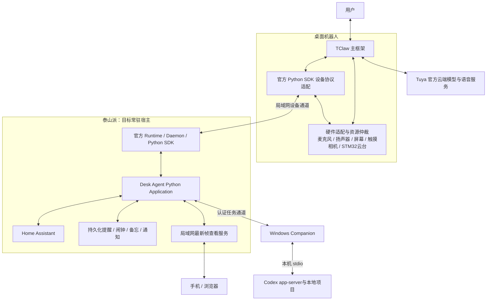

# 最新系统架构

用户确认的方向：TClaw 在机器人接入全部硬件、连接 Tuya 云端对话；兼容官方 Python SDK，经外部 Python Application 连接泰山派 HA、生活服务和 Windows Codex。本页和最新实施计划优先于旧报告的路线建议。

## 部署顺序

1. Windows 开发联调官方 SDK/Daemon/Application 与 Codex Companion，HA仍在泰山派。
2. 验证 Python版本/ARM依赖、Daemon、配对、重连、开机自启与资源余量。
3. SDK连接与生活服务迁移到泰山派常驻，Windows只负责Codex。电脑关闭时，机器人提醒播报仍须可用。

## 核心关口

- 新固件官方配对和媒体协议；TClaw与设备“Python SDK”模式共存。
- TClaw外部工具与Python Application之间的请求/结果通道；扩展先由A0/A2定义验证。
- 硬件唯一owner；SDK请求不绕过资源仲裁。
- IDF/LVGL/分区与板级依赖锁版本，不直接合并完整SDK或升级所有依赖。
- 泰山派ARM Runtime部署、相机吞吐与音频并发、运动限位和停止、原生媒体鉴权/加密均待验证。
- Codex受控thread与桌面聊天互通分开；HA调用回执与设备真实状态分开。

详见 [实施计划](../superpowers/plans/2026-10-11-desk-agent-system.md)。
