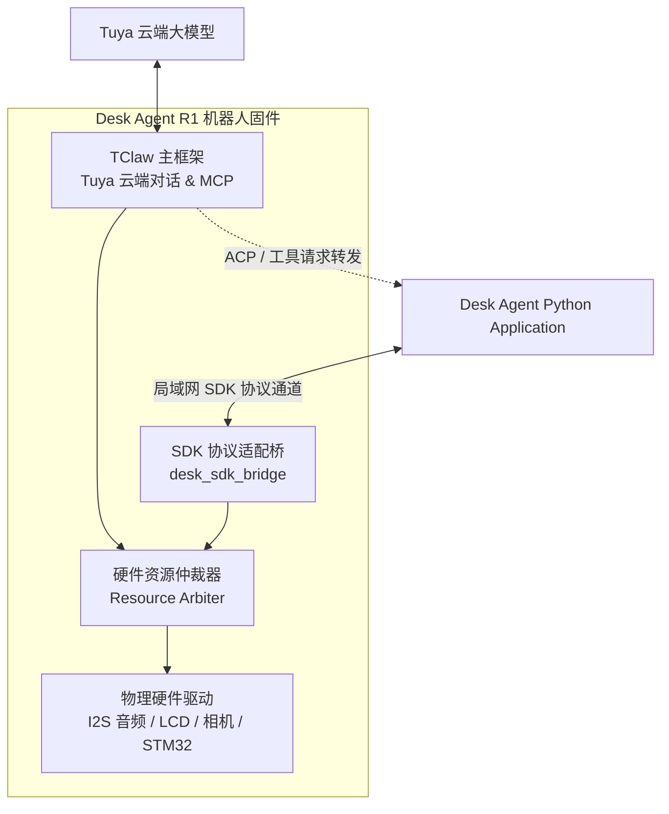

# Desk Agent R1 技术基线与依赖核验证明 (G0 Baseline)

> 文档版本：V1.0.0  
> 责任 Agent：A0 架构与协议  
> 核验日期：2026-10-11  
> 状态：G0 关口冻结 (Baseline Frozen)

---

## 1. 源码仓库与工作区映射台账

依据 `AGENTS.md` 工作区纪律与保护 Dirty 状态要求，对本地及相关代码资产进行只读扫描与定位，记录绝对路径、分支、Commit 及未提交状态：

| 仓库 / 资产角色 | 本地绝对路径 | 远端 Repository URL | 分支 / 标签 | Commit SHA | 工作区状态 (Dirty / Clean) | 说明 |
| :--- | :--- | :--- | :--- | :--- | :--- | :--- |
| **DeskAgent (主仓)** | `/home/maidang/DeskAgent` *(Samba: `/home/share/samba/ePanda/DeskAgent`)* *(Windows: `D:/ePanda/DeskAgent`)* | `https://github.com/Xepanda/DeskAgent` | `main` | `9a22a4be9457a2edfa883e8f696edae8ff7feaa6` | **Clean** *(除 A0 本次交付外)* | 本项目主资料库与契约规范仓库 |
| **Tuya TClaw** | `/home/maidang/.gemini/antigravity-cli/brain/49ffa309-8e24-433a-a0da-2c22b3c125ea/scratch/tclaw-repo` | `https://github.com/tuya/TClaw.git` | `master` | `88bd37378f1d106fcc1175e61b368222cc8fabda` | **Dirty** (`?? .share/`) | 机器人端主框架，包含 MCP 工具、ACP 客户端与 Tuya 对话主循环 |
| **WatcheRobot Python SDK** | `/home/maidang/.gemini/antigravity-cli/brain/cb82573a-ba9b-42ea-a6be-405983e79f69/scratch/watcherobot_python_sdk` | `https://github.com/orulink-ai/WatcheRobot_python_sdk.git` | `detached HEAD` | `8bc13967a06ef073459be47e930ff43ef37ee8fb` | **Clean** (锁定 Release 0.1.11) | 官方 Python SDK/Daemon/Runtime，定义设备协议、Opus 解码与通道 |
| **WatcheRobot Embedded SDK** | `/home/maidang/.gemini/antigravity-cli/brain/cb82573a-ba9b-42ea-a6be-405983e79f69/scratch/watcherobot_public` | `https://github.com/orulink-ai/WatcheRobot-public.git` | `detached HEAD` | `646a977bfd76a8516ae505fda2331b81e1049b87` | **Clean** (锁定预览版本) | 包含 ESP32-S3 HAL（Audio/LCD/Touch/Camera/STM32 Body） |
| **TuyaOpen SDK** | `/home/maidang/TuyaOpenIDE/TuyaOpenSDK` | `https://github.com/tuya/TuyaOpen` | `master` | `4ef78546989e7c6e455bc5d865bba965e595c3a2` | **Dirty** (`D lang_config.h`, `M cipher_wrapper.c`, `M mqtt_service.c`, `M tuya_iot_dp.c`, `M tos.py`) | TuyaOpen 基础框架与 ESP32 BSP |
| **wl_robot (参考工程)** | `/home/maidang/TuyaOpenIDE/projects/wl_robot` | `https://github.com/Xepanda/wl_robot.git` | `md/motion-actions-v5` | `7e9e6645034a02eea8efd7602e25989832ca36cf` | **Dirty** (`M source/miniapp/src/devices/schema.ts`) | 轮足机器人现有固件工程，保护其本地状态 |
| **Samba TuyaOpen** | `/home/share/samba/ePanda/TuyaOpen` | `https://github.com/tuya/TuyaOpen.git` | `fix/p2p-sdp-sscanf-stack-overflow` | `a0789b25be739a190364341f1adc0ace57c0ad7f` | **Dirty** (`?? boards/ESP32S3-new/` 等) | 外部既有分支，只读观察，严禁修改 |

> [!IMPORTANT]
> **工作区纪律严格声明**：A0 仅在 `/home/maidang/DeskAgent` 内新增 `docs/implementation/` 与 `contracts/`，绝对不切换、暂存、修改或清理上述任何外部仓库的未提交修改。

---

## 2. 硬件规格与未知项台账 (Hardware & Unknowns)

| 硬件子系统 | 规格与接口已知项 | 来源证据 | 目标整机当前未知项 (Unknowns) | 证据层级 |
| :--- | :--- | :--- | :--- | :--- |
| **主控 (MCU)** | ESP32-S3 双核 Xtensa LX7，8 MB Octal PSRAM | V1.0 DOCX、WatcheRobot VALIDATION.md | 目标板实际芯片修订版本 (rev 0.x)、实际 Flash 颗粒型号 | Level 1 (文档证据) |
| **存储 (Flash & 分区)** | 标称 32 MB 物理 Flash，示例工程按 16 MB 编译 | WatcheRobot `VALIDATION.md` | 目标设备当前烧录的分区表、OTA 分区大小、NVS 与 SPIFFS 空间 | Level 1 (文档证据) |
| **身体控制 (Body MCU)** | STM32 芯片，UART/SPI 交互，`watche_hw_body` 协议 | `watche_hw_body.h`、`body_protocol.c` | STM32 固件版本与 hash、真实云台机械限位、物理 Stall 保护阈值 | Level 1 (文档证据) |
| **相机 (Camera)** | Himax HX6538 协处理器，PTL/SSCMA 协议，输出 JPEG | `watcher_hx_ptl`、`hal_camera.c` | 传感器型号、镜片 FOV、Himax 固件版本/Hash、持续捕获发热与帧间隔 | Level 1 (文档证据) |
| **显示与触摸 (LCD & Touch)** | 包含 SPD2010 LCD/Touch 驱动，圆形屏，LVGL 适配 | `hal_display.c`、`esp_lcd_touch` | 物理面板分辨率、触摸绝对坐标映射、背光 PWM 控制脚 | Level 1 (文档证据) |
| **音频 (Audio Codec)** | ES8311 DAC + ES7210 ADC (或同级 Codec)，16k/24k mono | `hal_audio.c`、`esp_codec_dev` | 麦克风灵敏度、底噪与拾音距离、AEC 硬件回音抵消参考引脚 | Level 1 (文档证据) |
| **供电与传感器** | 电池/Type-C 供电，板载 IMU (部分板型) | 产品草案 | 目标硬件是否有硬件 RTC 备份供电、电量计型号、断电自愈特性 | **未知** (待现场录入) |

---

## 3. IDF 与 LVGL 兼容性矩阵与技术裁决

### 3.1 兼容性冲突现状核验

1. **ESP-IDF 版本差异**：
   - `WatcheRobot-public` 嵌入式 SDK 在 `firmware/sdk/examples/robot/main/idf_component.yml` 中锁定 `idf: "==6.0.2"`。
   - `TuyaOpenSDK` 在 `platform/ESP32/esp-idf` 中运行的是 `ESP-IDF v5.4`。
   - 依赖分析：检查 `WatcheRobot-public/firmware/sdk/components/hal/` 源码发现，其主要驱动（I2S 音频、SPI/I80 LCD、UART 身体控制）调用的是标准的 ESP-IDF HAL 与 Espressif 组件（`esp_codec_dev`, `esp_lcd_touch`），并没有深度绑定 IDF 6.0 专有不可移植特性。
2. **LVGL 版本冲突**：
   - `WatcheRobot-public` 依赖 `lvgl/lvgl: "8.4.0"`，并配套 `esp_lvgl_port: 2.x`。
   - `TuyaOpenSDK` 自带 `src/liblvgl/v8` (8.3.9) 和 `src/liblvgl/v9` (9.1.0)。Tuya AI 语音交互与 UI 常用 LVGL 9。
   - LVGL 8 与 LVGL 9 在底层绘制缓冲、样式 API（`lv_obj_set_style_*`）及对象生命周期上存在破坏性不兼容。

### 3.2 A0 架构裁决 (Architecture Decision)

> **裁决原则：以主框架 TuyaOpen (ESP-IDF 5.4) 为锚点，下层隔离封装硬件驱动，禁止全局升级 IDF 依赖。**

1. **IDF 基线锁定**：固件工程锁定 **ESP-IDF v5.4**（TuyaOpen 官方支持环境）。严禁尝试将整个 TuyaOpen 或现有项目依赖强行升级至 IDF 6.0.2，避免引发 TLS、LWIP、FreeRTOS 及 Tuya 云协议栈的底层回归。
2. **硬件驱动抽取 (`desk_hardware`)**：
   - A1 将 WatcheRobot 目标板的 HAL 驱动（音频 ES8311/ES7210、屏幕 SPD2010、STM32 身体控制、HX6538 相机交互）抽取并适配至 IDF 5.4，作为独立的内部组件 `firmware/components/desk_hardware/`。
3. **UI 与表情层裁决**：
   - 桌面机器人以表情和状态显示为主，采用 TuyaOpen 经实测验证的图形方案；
   - 屏幕与表情绘制归属单一 UI Owner，底层硬件 display handle 加互斥锁（Display Mutex），禁止 Python SDK 与 TClaw 同时直接绘制显存。

---

## 4. 官方 Python SDK 协议与部署限制

### 4.1 协议机制深度核验

经核验 `WatcheRobot_python_sdk`（Commit `8bc13967a06ef073459be47e930ff43ef37ee8fb`）源码：
1. **控制信封**：
   - 格式：`{"type": message_type, "code": 0, "data": {"command_id": command_id, ...}}`。
   - 客户端在建立连接时发送 `sys.client.hello` (`role: "desktop"`），设备/服务端回复 `sys.ack`。
2. **二进制多媒体流 (WSPK)**：
   - 头部 16 字节：`b"WSPK" + frame_type(1B) + flags(1B) + stream_id(2B) + sequence(4B) + payload_size(4B)`。
   - 音频帧 (`frame_type = 1`)：设备端麦克风采集输出 16 kHz 单声道 Opus（60ms/包），SDK 依靠 `av` (PyAV) 解码为 16 kHz s16le PCM。
   - 下行播放：SDK 发送 24 kHz 单声道 s16le PCM，受设备声明的 `audio.stream` capability 门控。
3. **管理与应用运行**：
   - 官方应用通过 `watcherobot app run` 启动，由 Daemon 为其注入标准 channels（包含 `send_command`, `send_audio_stream` 等）。

### 4.2 宿主环境与部署限制

1. **Python 版本**：官方 SDK 明确要求 `Python >= 3.10, <= 3.12`。当前 Ubuntu 宿主机为 Python 3.14，后续在泰山派与联调环境必须创建 Python 3.11 独立隔离虚拟环境（venv 或 Docker）。
2. **PyAV (Opus 解码) ARM64 限制**：
   - PyPI 上 `av 16.0.1` 提供了 CPython 3.11 的 Linux ARM64 manylinux wheel，避免了在泰山派上现场编译 FFmpeg。
   - 但泰山派（RK3566，2GB RAM）上必须验证 glibc 版本与动态链接依赖，严禁在无内存监控情况下运行无界解码缓冲。
3. **配对与网络通道**：
   - 官方首次配对使用 BLE。在泰山派 Linux ARM 上，若缺少 BLE 适配，必须支持局域网直连或读取已保存的配对证书进行重连。

---

## 5. TClaw 与 SDK 模式共存条件与仲裁设计

### 5.1 共存核心冲突

在原生 WatcheRobot 架构中，设备仅作为“哑外设”（Slave），由主机 Python Daemon 全权控制。而在 Desk Agent R1 最新架构中：
**TClaw 是设备端主框架，直接连接 Tuya 官方云端对话模型。**

### 5.2 共存条件与三级仲裁机制

1. **音频资源仲裁 (Audio Arbitration)**：
   - **TClaw 优先级高于外部播放**：当用户唤醒 TClaw 或进入 Tuya 对话时，TClaw 标记 `AUDIO_OWNER_TCLAW`。外部 Python SDK 的 `ctrl.audio.play` 或 `play_pcm` 请求将被拒绝并返回 `RESOURCE_BUSY`。
   - **打断 (Interrupt) 机制**：用户触摸或语音打断时，仲裁器首先停止当前扬声器 DMA 传输，并向两端发送状态更新事件。
2. **相机与云台仲裁 (Camera & Motion Arbitration)**：
   - **查看会话租约 (Viewing Lease)**：外部 LAN Web 页面请求查看画面时，需先申请 `resource.camera.acquire`，获取有限租约（默认 10 秒，需持续心跳刷新）。
   - **运动锁定**：在相机租约激活期间，仲裁器锁定自动跟随动作，仅允许人工手动受控微调云台（`resource.motion.move`）；禁止 TClaw 自动表情转头破坏画面。
   - **租约失效释放**：若客户端超时未续租或网络断开，仲裁器立即调用相机 stop，释放帧缓存。
3. **外部工具调用通道 (MCP / ACP Bridge)**：
   - TClaw 内建 MCP 工具机制（参考 `tool_openclaw_ctrl.c` 及 `acp_client.c`）。
   - 当 Tuya 云端识别到智能家居（HA）、工程辅助（Codex）或生活提醒（Life）意图时，TClaw MCP 工具通过本地 WebSocket / RPC 通道将结构化请求（`RequestEnvelope`）派发给常驻的 Python Application。
   - Python Application 执行完成后，将结果结构（`ResponseEnvelope`）异步回传给 TClaw，由 TClaw 组织自然语言向用户播报。

---

## 6. A0~A7 实际 Ownership 映射与合入治理

严格执行 `AGENTS.md` 边界划分：

| 工作包 | 责任模块 | 实际文件与目录路径 | 跨模块依赖与输入契约 | 预期合入顺序 |
| :--- | :--- | :--- | :--- | :--- |
| **A0** | 架构与协议 | `docs/implementation/` `contracts/` | 输入：调研报告、官方 SDK 协议 输出：基线规范、JSON Schemas、可校验 Fixtures | **第 1 位 (本次已合入)** |
| **A1** | 设备固件主框架 | `firmware/components/desk_hardware/` `firmware/components/desk_tclaw/` `firmware/main/` | 依赖 A0 契约；提供统一硬件驱动 API 与资源仲裁句柄 | 第 2 位 (与 A2 协同) |
| **A2** | 官方 SDK 适配桥 | `firmware/components/desk_sdk_bridge/` `tests/sdk_contract/` | 依赖 A0 `contracts/` 与 A1 仲裁 API；提供设备端 SDK 兼容通道 | 第 3 位 (与 A1 共同交付 G1) |
| **A3** | Python 核心与生活服务 | `host/desk_agent/core/` `host/desk_agent/services/` `deploy/edge/` | 依赖 A0 契约及 A2 提供的 SDK 通道；实现 SQLite 持久化调度 | 第 4 位 (并行) |
| **A4** | Home Assistant 接入 | `host/desk_agent/connectors/ha/` `tests/connectors/ha/` | 依赖 A0 `domain_ha.json`；提供 HA 状态与安全执行 | 第 5 位 (并行) |
| **A5** | Windows Codex 伴侣 | `companion/` `deploy/windows/` `tests/companion/` | 依赖 A0 `domain_codex.json`；管理本地 `codex app-server` stdio | 第 6 位 (并行) |
| **A6** | LAN 相机与 Web 控制台 | `host/desk_agent/camera/` `web/` `tests/camera/` | 依赖 A0 `domain_resource.json` 与 A2 相机租约接口 | 第 7 位 (相机通道确认后) |
| **A7** | 系统集成与验证 | `tests/e2e/` `tools/verification/` `docs/acceptance/` | 联合所有模块执行 G2~G4 验证，记录客观证据 | 第 8 位 (最终验收) |

> [!NOTE]
> 当 A1 与 A2 修改同一固件启动入口 (`firmware/main/app_main.c`) 时，由 A1 负责合入主入口并调用 A2 暴露的适配初始化函数，A2 仅提交接口声明与补丁。
