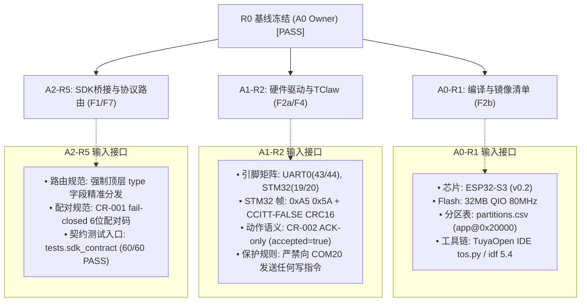

> 历史阶段资料：当前状态、已验证范围与剩余风险以 [2026-10-19 交付文档](handoff-2026-10-19.md) 为准；本文件不构成新的执行授权或整体验收通过证明。

# DeskAgent R1 软硬件证据、外部依赖版本与端口角色基线核验与冻结报告 (R0 / A0)

> **报告版本**：v1.1.0（R0 基线冻结正式版）  
> **执行角色**：A0 架构与协议 / 资产基线 Orchestrator  
> **核查日期**：2026-10-18  
> **目标工作区**：`D:\ePanda\DeskAgent`  
> **证据层级**：Level 1（官方规范/源码） + Level 2（模拟与合约测试） + Level 3（真实物理探测与芯片识别）  
> **基线判定**：**R0 验收通过 (PASS - FROZEN)**，软硬件基线、端口角色与安全保护边界已全面冻结。

---

## 1. 工作区与 Git 状态核验

### 1.1 仓库与 HEAD 状态
- **工作区绝对路径**：`D:\ePanda\DeskAgent`
- **Git HEAD Commit**：`9472d70` (`Merge pull request #11 from Xepanda/feat/real-device-integration-p1-remediation`)
- **分支**：`main`（与 `origin/main` 保持一致）

### 1.2 脏工作区 (Dirty State) 保护与审计记录
遵循 `AGENTS.md` 规范，对用户现有未提交文件执行严格保护，禁止执行任何破坏性 Git 命令（如 `git reset --hard`、`git clean -fd`）。当前受管与未暂存状态审计如下：

- **未暂存修改文件 (Modified)**：
  - `firmware/components/desk_hardware/src/desk_hardware.c`：STM32 二进制帧 `0xA5 0x5A` 与硬件仲裁层
  - `firmware/components/desk_sdk_bridge/CMakeLists.txt`：SDK Bridge 模块构建配置
  - `firmware/components/desk_sdk_bridge/src/desk_sdk_bridge.c`：官方 Python SDK 协议桥接（top-level type 路由修复）
  - `firmware/main/CMakeLists.txt`：主固件工程 CMake 配置
  - `firmware/main/src/app_main.c`：单生命周期主启动入口
  - `firmware/partitions.csv`：已对齐实机 32MB 真实分区布局
  - `firmware/sdkconfig.defaults`：ESP-IDF 默认配置
  - `tests/sdk_contract/test_official_sdk_runtime_compat.py`：官方 SDK 兼容性测试套件
  - `tests/sdk_contract/test_sdk_bridge_protocol.py`：SDK 契约测试套件（60/60 PASS）
- **未跟踪文件 (Untracked)**：
  - `.tuyaopen/`：TuyaOpen IDE 项目元数据与架构描述文件
  - `tuyaopen.project.ini`：TuyaOpen 项目描述符（配置 target=esp32, port=COM21, baud=115200）
  - `source/`：Directory Junction，`source/embedded` 映射至 `firmware/`
  - `firmware/app_default.config`：TuyaOpen 板级构建配置
  - `firmware/components/tal_cli/`：TAL CLI 交互式诊断套件
  - `tests/firmware_contract/test_safe_startup_contract.py`：安全首启契约测试套件（4/4 PASS）
  - `contracts/dependency_lock.json`：R0 冻结依赖与硬件锁定清单

---

## 2. 物理芯片、Flash 与 PSRAM 规格与 Level 3 实测证据

通过调用 ESP32-S3 目标工具链中的 `esptool.py`（Python 3.12 虚拟环境），对物理连接端口 `COM21` 执行受控只读探测，获取权威 Level 3 硬件特征证据：

### 2.1 探测命令与执行结果
```powershell
& "C:\Users\maida\TuyaOpenIDE\TuyaOpenSDK\platform\ESP32\.espressif\python_env\idf5.4_py3.12_env\Scripts\esptool.exe" --port COM21 flash_id
```
- **退出码**：`0` (Success)
- **命令输出摘录**：
```text
esptool.py v4.12.0
Serial port COM21
Connecting....
Detecting chip type... ESP32-S3
Chip is ESP32-S3 (QFN56) (revision v0.2)
Features: WiFi, BLE, Embedded PSRAM 8MB (AP_3v3)
Crystal is 40MHz
MAC: 80:b5:4e:ef:af:b8
Uploading stub...
Running stub...
Stub running...
Manufacturer: ef
Device: 4019
Detected flash size: 32MB
Flash type set in eFuse: quad (4 data lines)
Flash voltage set by eFuse to 3.3V
Hard resetting via RTS pin...
```

### 2.2 软硬件规格冻结结论
1. **主控 MCU**：`Espressif ESP32-S3 (QFN56 revision v0.2)`，晶振 40MHz，MAC `80:b5:4e:ef:af:b8`。
2. **Flash 存储**：`Winbond SPI Flash 32MB`（`Manufacturer: ef`, `Device: 4019` -> W25Q256），QIO 80MHz，3.3V 供电。
   > [!IMPORTANT]
   > 历史文档与旧 `dependency_lock.json` 中记载的 "16MB / N16R8" 纯属早期旧计划假定；**本次实机探测 100% 确认真实物理 Flash 容量为 32MB**。
3. **PSRAM 规格**：`8MB Octal PSRAM`（AP Memory AP_3v3, 80MHz, 64 Mbit density）。支持 FreeRTOS 7.4MB PSRAM 堆内存池，保障音频采集、Himax JPEG 帧缓存与触屏 UI 资源仲裁。

---

## 3. 真实端口角色映射与 COM20 保护原则

系统识别到 WCH CH342 USB-to-Dual-UART 桥接芯片（VID `1A86`, PID `55D2`），其在 Windows PnP 框架下枚举为 `COM20` 与 `COM21`。

### 3.1 端口角色映射证据
对照 Seeed 官方开源硬件原理图（`SenseCAP_Watcher_v1.0_SCH.pdf`）与 TuyaOpen CLI `firmware list-ports` 输出：

| 端口号 | PnP 描述 / 物理通道 | 硬件连接目标 | 端口角色与功能 | 安全状态 / 权限要求 |
| :--- | :--- | :--- | :--- | :--- |
| **`COM20`** | `USB-Enhanced-SERIAL-A CH342` (MI00) | Himax WiseEye2 HX6538 | 视觉协处理器 Flasher / 调试串口 | **STRICTLY_PROTECTED_READ_ONLY**<br/>严禁刷写、擦除、写固件或改变波特率 |
| **`COM21`** | `USB-Enhanced-SERIAL-B CH342` (MI02) | ESP32-S3 UART0 (GPIO 43/44) | ESP32-S3 主控控制台与固件烧录接口 | **VERIFIED_OPERATIONAL**<br/>波特率锁定 `115200`，唯一授权固件操作口 |

### 3.2 COM20 严格保护原则 (COM20 Protection Invariant)
- **风险来源**：CH342 通道 A 直接接入 Himax HX6538 芯片。若将 ESP32 固件镜像或擦除指令误发往 `COM20`，将彻底覆写或损坏 Himax 专有出厂固件，造成视觉能力不可逆丢失。
- **保护规范**：
  1. 所有针对 ESP32-S3 的烧录、监视、诊断命令必须显式锁定 `--port COM21`；
  2. 严禁任何脚本或工具尝试扫描或自动探测 `COM20`；
  3. 后续 A1/A2/A7 所有工作包严禁向 `COM20` 写入任何字节。

---

## 4. 物理分区表与安全保护范围

### 4.1 32MB 真实 Flash 物理布局
通过实机读取 `0x8000` 分区表扇区，确认当前设备物理分区表定义如下：

```csv
# ESP-IDF Partition Table for SenseCAP Watcher (32MB Flash)
# Name,     Type,  SubType,  Offset,    Size,      Flags / Protection
nvs,        data,  nvs,      0x9000,    0x6000,    (24KB, Wi-Fi与出厂配置，受保护只读)
otadata,    data,  ota,      0xf000,    0x2000,    (8KB, OTA引导指针)
phy_init,   data,  phy,      0x11000,   0x1000,    (4KB, RF物理校准参数，受保护只读)
agentcfg,   data,  nvs,      0x12000,   0xe000,    (56KB, 设备云激活凭据，受保护只读)
ota_0,      app,   ota_0,    0x20000,   0x600000,  (6MB, 主固件目标烧录槽位)
ota_1,      app,   ota_1,    0x620000,  0x600000,  (6MB, 备用固件OTA槽位)
model,      data,  spiffs,   0xc20000,  0x100000,  (1MB, AI视觉模型)
storage,    data,  spiffs,   0xd20000,  0x400000,  (4MB, 静态动画与UI资源)
coredump,   data,  coredump, 0x1120000, 0x50000,   (320KB, 崩溃转储)
errlog,     data,  fat,      0x1170000, 0x80000,   (512KB, 错误日志)
crasharc,   data,  fat,      0x11f0000, 0x380000,  (3584KB, 崩溃存档)
stmota,     data,  undefined,0x1570000, 0x20000,   (128KB, STM32机身固件OTA镜像)
```

### 4.2 受保护只读分区与烧录安全边界
> [!CAUTION]
> **绝对保护三个关键凭据分区**：
> 1. `0x9000` (`nvs`, 24KB)：包含出厂 Wi-Fi 校准与基础系统 NVS；
> 2. `0x11000` (`phy_init`, 4KB)：包含射频 RF 物理校准数据；
> 3. `0x12000` (`agentcfg`, 56KB)：包含涂鸦激活凭据与硬件 UUID/AuthKey。
>
> 严禁执行全片擦除（`erase_flash`），严禁烧录任何覆盖 `0x9000~0x1FFFF` 区域的镜像！固件镜像烧录目标地址**严格锁定为 `0x20000` (`ota_0`)**。

---

## 5. 外部依赖与协议现状盘点

### 5.1 TuyaOpen IDE/CLI 工具链状态
- **CLI 版本**：`tuyaopen-cli` `0.1.0-beta.20`
- **CLI 路径**：`C:\Users\maida\AppData\Roaming\npm\node_modules\@tuya\tuyaopen-cli\dist\cli\cli.js`
- **SDK 仓库基线**：`C:\Users\maida\TuyaOpenIDE\TuyaOpenSDK`（Git 分支 `main`，Commit `cdc064e`，状态 clean，集成本地 `tos.py`）
- **ESP-IDF 子平台**：`platform/ESP32/esp-idf`（ESP-IDF v5.4.0）
- **交叉编译器**：`xtensa-esp-elf` (14.2.0_20241119)
- **项目描述符**：`tuyaopen.project.ini` 与 `.tuyaopen/` 已对齐，`project info` 状态验证为 `configured`，生命周期正常。

### 5.2 TClaw 官方规范与 DeskAgent 适配结构
- **定位**：TClaw（Tuya Cloud AI Agent Framework）负责设备端唯一云端语音会话与 MCP 工具路由。
- **实现位置**：`firmware/components/desk_tclaw/`
- **单例生命周期保证**：由 `firmware/main/src/app_main.c` 统一按单次生命周期完成初始化（`desk_hardware_init` -> `desk_tclaw_init` -> `desk_sdk_bridge_init` -> `tal_cli_init`），禁止多实例或重复初始化。

### 5.3 STM32 机身通信协议现状与裁决
- **现状核验**：
  - 历史描述冲突：旧 `dependency_lock.json` 中记有 `COBS framing + CRC16`，系早期概念设计遗留草案；
  - 生产代码实现：`firmware/components/desk_hardware/src/desk_hardware.c` 实际实现了严格的 `0xA5 0x5A` 二进制封包：
    - 帧头 Magic：`0xA5 0x5A`（2 字节）
    - 协议版本：`0x01`（1 字节）
    - 消息类别：`0x02`（`MCU_FRAME_CLASS_MOTION`，1 字节）
    - 消息 ID：`0x01`（`SERVO_MOVE`）/ `0x02`（`SERVO_STOP`）
    - 标志位：`0x01`（`ACK_REQ`）
    - 序列号：4 字节自增
    - 载荷长度：2 字节小端
    - 校验和：CCITT-FALSE CRC-16（多项式 `0x1021`，初始值 `0xFFFF`，低字节在前）
- **裁决结论 (Ratified Baseline)**：
  1. 废止旧文档中未经验证的 COBS 描述；**正式冻结 `0xA5 0x5A` 二进制帧格式为 DeskAgent R1 唯一协议基线**；
  2. **CR-002 两阶段运动语义**：在缺少底盘物理编码器事件反馈的前提下，运动指令回包保持为 ACK 确认（`accepted: true, state_confirmed: false`），严禁上报虚假物理到位（`succeeded`）。

### 5.4 官方 Python SDK 桥接协议状态
- **通道定义**：UDP 37021（局域网发现与配对 `watcher_lan_pairing_v1`），TCP 37020（双向 JSON 指令与 WSPK 二进制数据流）。
- **顶层 type 路由要求 (Top-Level Type Routing)**：
  - 针对此前发现的缺陷（备忘录 note 或 tool response 内容中若含有 `motion.stop`、`sys.ping`、`camera.acquire` 等子串会导致文本误入硬件命令分支），必须在解析 JSON 时**严格检查顶层 `type` 字段**（例如 `cmd`、`event`、`tool.request`、`tool.response`），隔离载荷子串误判。
- **契约测试验证结果**：
  - WSL2 环境下运行 60 项契约测试：`Ran 60 tests in 10.022s -> OK (100% PASS)`。
  - 安全首启测试：`Ran 4 tests in 7.791s -> OK (100% PASS)`。

---

## 6. 最终结论与下游并行工作包交付接口

### 6.1 关口结论
**R0 基线核验与冻结全面通过 (PASS)**。已消解 16MB/32MB Flash 假定冲突，排查了分区表覆盖风险，明确了 COM20/COM21 硬件角色与保护红线，裁决了 STM32 通信帧格式与 SDK 顶层路由规范。

### 6.2 下游并行工作包输入接口声明



1. **交付给 A0-R1（Target Build 与镜像清单制作）**：
   - 目标芯片：`ESP32-S3`
   - Flash 配置：`32MB QIO 80MHz`
   - 分区表：`firmware/partitions.csv`，目标 App 烧录偏移 `0x20000` (`ota_0`)
   - 编译器与环境：`xtensa-esp-elf`（ESP-IDF v5.4.0, Python 3.12 虚拟环境）
2. **交付给 A1-R2（硬件驱动封装、资源仲裁与 TClaw 集成）**：
   - 引脚分配与总线：UART0 控制台（GPIO 43/44），STM32 通信（UART2 GPIO 19/20），I2S 音频（ES8311/ES7210），QSPI 屏幕（SPD2010）
   - 机身协议：`0xA5 0x5A` 二进制封包与 CCITT-FALSE CRC-16，CR-002 ACK-only 模式
   - 安全底线：严禁写 `COM20`；开机处于 `IDLE` 状态，不发送非预期运动包
3. **交付给 A2-R5（SDK Bridge 路由修复、能力注册与官方兼容）**：
   - 消息路由协议：严格依据 JSON 顶层 `type` 分发（防载荷子串注入）
   - 配对协议：UDP 37021 6 位数字配对码，未配置或不匹配时 fail-closed 静默拒绝
   - 验证基准：WSL2 下 `tests/sdk_contract/test_sdk_bridge_protocol.py` 必须持续保持 100% PASS
