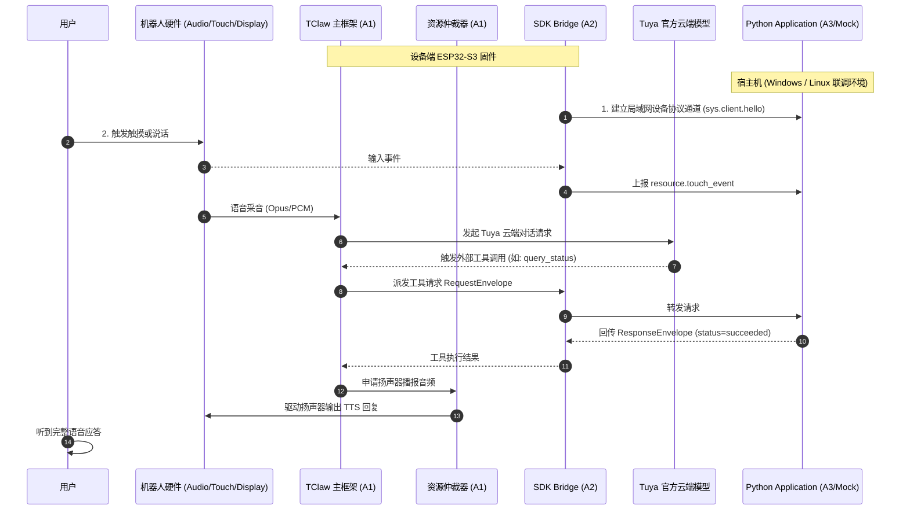

# Desk Agent R1 G1 最小贯通验证方案与 A1/A2 派发规范

> 文档版本：V1.0.0  
> 责任 Agent：A0 架构与协议  
> 关口目标：G1 设备最小贯通 (Minimal Vertical Slice)  
> 前置依赖：G0 基线与公共契约已冻结 (`docs/implementation/baseline.md`, `contracts/`)

---

## 1. G1 核心目标与验证定义

### 1.1 验证目标

证明 Desk Agent R1 的最新系统架构在目标硬件上**真实成立且模式不互斥**：
1. **主框架在线**：ESP32-S3 目标硬件运行 TClaw 主框架，能够与 Tuya 官方云端对话模型完成一轮完整语音问答（采音 → 云端识别与思考 → 扬声器播报）；
2. **SDK 通道并行**：官方 WatcheRobot Python Runtime / Application 同时与设备端建立稳定通道；
3. **事件与控制贯通**：在 TClaw 会话存续期间，Python Application 能实时接收到一次触摸/按键输入事件，并通过 SDK 通道执行一次受限硬件操作（如设置表情或安全限位内的微动）；
4. **外部工具闭环**：TClaw 云端对话触发一次外部工具调用，通过桥接通道交由 Python Application 处理，Application 返回结构化结果，TClaw 成功完成回复。

> [!CRITICAL]
> **G1 关口原则**：G1 是主架构存亡决策门。若实验失败，必须定位是协议模式、网络通道还是硬件资源竞争原因，**严禁在未记录事实前擅自推翻主架构或私自修改已冻结契约**。

---

## 2. 实验拓扑与模块协作矩阵



---

## 3. 关键观察点与指标收集表

A1 与 A2 在联合执行 G1 时，必须逐项收集并填报下列观察数据：

| 观察项 ID | 观测阶段 | 观察点与判定标准 | 证据采集方式 |
| :--- | :--- | :--- | :--- |
| **OBS-01** | SDK 握手 | Python SDK 成功连接设备，完成 `sys.client.hello` / `sys.ack`，设备 capabilities 正常协商 | Python SDK 客户端日志 + 固件串口终端日志 |
| **OBS-02** | 触摸事件 | 按下目标板触摸键（backtouch / screentouch），Python Application 在 100ms 内收到 `resource.touch_event` | Application 事件日志时间戳对比 |
| **OBS-03** | 云端会话 | 用户说出固定测试语料，TClaw 成功向 Tuya 云发起请求，云端返回文本与语音流 | 固件串口 `ai_agent` 交互日志 |
| **OBS-04** | 工具转发 | Tuya 云端触发工具调用后，Bridge 在 500ms 内将请求送达 Python Application | Bridge 与 Application 两端 `request_id` 匹配日志 |
| **OBS-05** | 结果回传 | Application 成功响应 `ResponseEnvelope`，TClaw 正确解析并纳入对话轮次上下文 | TClaw 上下文构建日志 |
| **OBS-06** | 语音播报 | TClaw 驱动扬声器播报完成，无破音、无 I2S 挂起、无显存死锁 | 真实音频录音/听感证据 + 任务状态 |
| **OBS-07** | 内存与低水位 | 对话与并发控制全过程，内部 SRAM 最小空闲 > 30 KB，PSRAM 最小空闲 > 2 MB | 固件 `esp_get_free_heap_size()` 打印 |

---

## 4. 失败分类与应急处理规则 (Failure Triage)

| 失败类别 | 现象特征 | 根本原因推断 | 处理与裁决规范 |
| :--- | :--- | :--- | :--- |
| **Category A: 协议模式互斥** | SDK 连接后 TClaw 无法采音，或 TClaw 启动后 SDK 端口被关闭 | 原生 SDK 固件假定独占设备连接，与 TClaw 网络监听冲突 | 由 A2 优化 Bridge 监听逻辑，确保轻量级事件端口与 TClaw 业务解耦，不强行使用官方闭源二进制 |
| **Category B: 内存耗尽 (OOM)** | 固件在连接云端或初始化 SDK 通道时发生 Heap 崩溃重启 | Tuya TLS + WSPK 缓冲区 + 堆栈同时开辟超出 PSRAM 限制 | 限制 WSPK 帧缓冲队列长度（设为有界 2 帧），缩小 JSON 解析临时 buffer，排查内存泄漏 |
| **Category C: 音频资源竞争** | TClaw 播报时产生严重噪声或死锁 | TClaw 与 SDK 音频组件同时竞争 I2S DMA 控制器 | 强制所有音频操作通过 A1 `Resource Arbiter`，严格遵循单 Audio Owner 互斥锁 |
| **Category D: 工具响应超时** | TClaw 超时放弃等待，直接报错给用户 | 本地 Bridge 到 Python 进程通道受阻或调度延迟超过 5s | 检查局域网通信时延，优化 Bridge 线程优先级，确保 Application 异步非阻塞处理 |

---

## 5. A1 / A2 派发提示词 (Dispatch Prompts)

依据 `AGENTS.md` 规则，按原子工作包分别派发给下一阶段执行者：

### 5.1 A1（设备固件）派发提示词

```text
执行实施计划工作包 A1：设备固件主框架与全硬件适配（G1 最小贯通阶段）。
工作区：/home/maidang/DeskAgent（其他机器使用实际检出路径）。
先读：AGENTS.md、README.md、docs/implementation/baseline.md、docs/implementation/g1-validation.md。

允许修改：
- firmware/components/desk_hardware/
- firmware/components/desk_tclaw/
- firmware/main/（主入口合入由 A1 负责）

禁止：
- 修改 SDK 协议外部适配组件（firmware/components/desk_sdk_bridge/ 由 A2 负责）；
- 修改 Python 业务代码或全局升级 ESP-IDF / LVGL 基线版本；
- 自行向云端或硬件刷入未经验证的代码。

输入：
- G0 冻结基线（ESP-IDF v5.4，TuyaOpenSDK）
- contracts/ 公共请求、事件、状态、错误契约与可校验 fixtures
- WatcheRobot-public 硬件 HAL 驱动参考源码

任务：
1. 搭建最小固件主工程，配置分区表与 ESP-IDF 5.4 构建脚本；
2. 封装音频 (ES8311/ES7210)、屏幕与触摸 (SPD2010)、STM32 身体控制驱动为 desk_hardware 组件；
3. 实现统一硬件资源仲裁器 (Resource Arbiter)，提供 Audio/Motion/Camera 互斥锁与所有权接口；
4. 跑通 TClaw 主循环，接通 Tuya 官方云端对话模型完成一轮真实语音问答；
5. 为 A2 暴露 Bridge 初始化钩子与事件分发句柄。

验收：
- 目标板通过串口日志证明完成一次采音、云端交互与扬声器播报；
- 串口打印内部 SRAM > 30KB，PSRAM > 2MB；
- 输出 G1 观察点 OBS-03、OBS-06、OBS-07 证据。
```

---

### 5.2 A2（SDK 兼容）派发提示词

```text
执行实施计划工作包 A2：官方 SDK 兼容与外部工具通道（G1 最小贯通阶段）。
工作区：/home/maidang/DeskAgent（其他机器使用实际检出路径）。
先读：AGENTS.md、README.md、docs/implementation/baseline.md、docs/implementation/interfaces.md、docs/implementation/g1-validation.md。

允许修改：
- firmware/components/desk_sdk_bridge/
- tests/sdk_contract/

禁止：
- 抢占或修改 A1 的硬件底层驱动（I2S / SPI / 串口初始化）；
- 自建独立的硬件连接或修改 A1 主启动入口（主入口变更由 A1 合入）；
- 伪造 Mock 宣称真机通过。

输入：
- WatcheRobot Python SDK 锁定 Commit 8bc13967a06ef073459be47e930ff43ef37ee8fb
- contracts/schemas/ 与 fixtures/
- A1 提供的资源仲裁器接口

任务：
1. 在 firmware/components/desk_sdk_bridge/ 中实现官方 Python SDK 协议端点；
2. 实现 sys.client.hello 握手与 capabilities（inputs, motion, camera, audio）协商；
3. 将底层的触摸/按键中断安全打包为 resource.touch_event 上报给 Python SDK；
4. 实现 TClaw MCP 工具与 Python Application 之间的双向 RequestEnvelope / ResponseEnvelope 通道；
5. 编写 tests/sdk_contract/ 契约联调验证脚本，并在受控环境下执行。

验收：
- 官方 Python SDK 客户端能成功连接固件 Bridge，完成握手与 capability 协商；
- 在 TClaw 对话存续期间，Python 侧成功接收触摸事件并回传一次工具结果；
- 输出 G1 观察点 OBS-01、OBS-02、OBS-04、OBS-05 证据。
```
