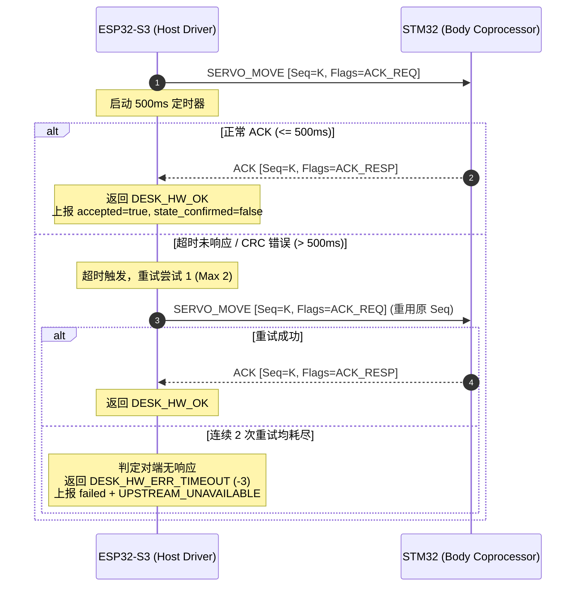

> 历史阶段资料：当前状态、已验证范围与剩余风险以 [2026-10-19 交付文档](handoff-2026-10-19.md) 为准；本文件不构成新的执行授权或整体验收通过证明。

# DeskAgent R3a STM32 机身通信协议裁决与规范冻结报告

> **文档版本**：v1.0.0（R3a 正式裁决版）  
> **责任 Agent**：A0 架构与协议裁决 (Architecture & Protocol Adjudication)  
> **裁决日期**：2026-10-18  
> **工作区**：`D:\ePanda\DeskAgent`  
> **状态**：**已裁决并冻结 (RATIFIED & FROZEN)**  
> **配套 Schema**：`contracts/schemas/stm32_body_protocol.json`  
> **依赖锁定**：`contracts/dependency_lock.json`  
> **下游输入工作包**：A1-R3b（STM32 驱动实现）、A7（协议验收与契约测试）

---

## 1. 裁决背景与历史冲突消解

### 1.1 历史冲突分析
在早期架构设计草案与历史记录中，存在针对 ESP32-S3 与 STM32 机身协处理器通信帧的两种互不兼容描述：
1. **旧依赖草案（历史记录）**：记有 `COBS framing + CRC16`（基于 Consistent Overhead Byte Stuffing 换行分帧）；
2. **DeskAgent 仓库实现**：包含基于固定双字节魔数 `0xA5 0x5A`、12 字节固定帧头、小端字段与 CRC16-CCITT-FALSE 的实现。Watcher board ops 进入 `desk_watcher_motion.c`；仓库另有 `desk_hardware.c` 接收实现。当前构建实际选用路径与 STM32 固件兼容性仍按 CR-007 待证。

### 1.2 A0 架构与协议裁决结论 (Adjudication Ruling)
依据 DeskAgent 仓库内协议实现与契约测试，A0 冻结 DeskAgent 主机侧合同。仓库源码和测试不等于当前 STM32 固件或当前板兼容证据；其证据边界由 CR-007 记录。

> [!IMPORTANT]
> **裁决一：COBS 不属于本主机侧串口发送合同**
> 历史文档中的 `COBS framing` 不属于当前 DeskAgent Watcher board motion 发送路径。本裁决不据此推断任意 STM32 固件均未采用 COBS。
>
> **裁决二：冻结 `0xA5 0x5A` 为 DeskAgent 主机侧协议合同**
> DeskAgent 主机端按 `0xA5 0x5A` 定长帧、12 字节头部、小端字段和 CRC16-CCITT-FALSE 编码/解析。该裁决规范 DeskAgent 发送和接收行为；在取得当前 STM32 固件来源、原始 RX/ACK 及 HIL 证据前，不将其表述为已验证的 ESP32-S3 ↔ 当前 STM32 设备协议。

---

## 2. 物理层与串口链路电气规范

| 参数项 | 规范要求 | 备注与安全要求 |
| :--- | :--- | :--- |
| **物理总线** | ESP32-S3 `UART_NUM_2` | 内部双板互连总线，与外部引脚隔离 |
| **TX 引脚 (ESP32-S3 输出)** | `GPIO 19` | 接入 STM32 机身 RX |
| **RX 引脚 (ESP32-S3 输入)** | `GPIO 20` | 接入 STM32 机身 TX |
| **波特率 (Baud Rate)** | `921600 bps` | 单字节传输耗时 ~10.85 µs，23 字节帧仅需 ~0.25 ms |
| **数据格式** | 8 数据位, 1 停止位, 无校验 (8-N-1) | 无硬件流控 (RTS/CTS 未连) |
| **电平标准** | 3.3V TTL 电平 | 严禁与 5V 容限直接短接 |
| **硬件隔离红线** | **严禁触碰 `COM20`** | `COM20` 为 Himax HX6538 视觉专用调试口，物理完全独立 |

---

## 3. 帧结构与字节序权威规范

所有跨字节数值（`uint16_t`、`int16_t`、`uint32_t`）在通信线上均严格采用**小端字节序（Little-Endian, LSB First）**传输。

### 3.1 帧布局总览 (Frame Layout)

```
+---------------+---------------+---------------------------------------+---------------+
| 帧头 Prefix   | 消息元数据    | 载荷 Payload (可变长 N 字节)           | 校验 CRC16    |
| (Offset 0..5) | (Offset 6..11)| (Offset 12 .. 11+N)                   | (12+N .. 13+N)|
+---------------+---------------+---------------------------------------+---------------+
| 6 字节        | 6 字节        | N 字节 (Move: 9B, Stop: 2B, ACK: 4B)   | 2 字节 (LE)   |
+---------------+---------------+---------------------------------------+---------------+
```

### 3.2 帧头固定结构（12 字节，Offset 0 ~ 11）

| 字节偏移 (Offset) | 字段名称 | 类型 | 字节序 | 允许值 / 枚举 | 语义定义 |
| :--- | :--- | :--- | :--- | :--- | :--- |
| **0** | `magic[0]` | uint8 | - | `0xA5` (165) | 帧起始同步字高字节 |
| **1** | `magic[1]` | uint8 | - | `0x5A` (90) | 帧起始同步字低字节 |
| **2** | `proto_version` | uint8 | - | `0x01` | 协议版本号（当前固定为 0x01） |
| **3** | `msg_class` | uint8 | - | `0x02` | 域类别：`MCU_FRAME_CLASS_MOTION` |
| **4** | `msg_id` | uint8 | - | `0x01`: MOVE<br/>`0x02`: STOP<br/>`0x00`: ACK<br/>`0xFF`: NACK | 消息/命令标识符 |
| **5** | `flags` | uint8 | - | Bit 0 (`0x01`): `ACK_REQ`<br/>Bit 1 (`0x02`): `ACK_RESP`<br/>Bit 2 (`0x04`): `NACK_RESP` | 控制标志位掩码 |
| **6 ~ 9** | `sequence` | uint32 | **Little-Endian** | `0` ~ `4,294,967,295` | 32 位单调自增帧序号（重试必须保持相同） |
| **10 ~ 11** | `payload_len` | uint16 | **Little-Endian** | `N` (Move: 9, Stop: 2, ACK: 4) | 载荷字节长度 |

---

## 4. 载荷（Payload）详细字段定义

### 4.1 舵机运动指令 (`SERVO_MOVE`, MsgID: `0x01`, Length: 9 字节)
- **下发标志**：`flags = 0x01` (`ACK_REQ`)
- **总帧长**：12 (Header) + 9 (Payload) + 2 (CRC) = **23 字节**

| 载荷偏移 | 绝对偏移 | 字段名 | 类型 | 字节序 | 范围与约束 | 说明 |
| :--- | :--- | :--- | :--- | :--- | :--- | :--- |
| **+0** | 12 | `axis_mask` | uint8 | - | `0x03` | 轴使能掩码：Bit 0 (Pan) + Bit 1 (Tilt) |
| **+1 ~ +2** | 13 ~ 14 | `pan_deg_x10` | int16 | **Little-Endian** | `0` ~ `1800` | 水平舵机目标角度 × 10（对应 0.0° ~ 180.0°） |
| **+3 ~ +4** | 15 ~ 16 | `tilt_deg_x10`| int16 | **Little-Endian** | `1000` ~ `1400`| 俯仰舵机目标角度 × 10（对应 100.0° ~ 140.0°） |
| **+5 ~ +6** | 17 ~ 18 | `duration_ms` | uint16 | **Little-Endian** | `100` ~ `65535`| 目标平滑过渡时间（毫秒） |
| **+7** | 19 | `profile` | uint8 | - | `0x00`: 平滑S曲线<br/>`0x01`: 线性<br/>`0x02`: 梯形快速 | 速度规划曲线 |
| **+8** | 20 | `source` | uint8 | - | `0x01` | 指令发起标识（0x01 表示标准执行） |

### 4.2 紧急与正常停止指令 (`SERVO_STOP`, MsgID: `0x02`, Length: 2 字节)
- **下发标志**：`flags = 0x01` (`ACK_REQ`)
- **总帧长**：12 (Header) + 2 (Payload) + 2 (CRC) = **16 字节**

| 载荷偏移 | 绝对偏移 | 字段名 | 类型 | 字节序 | 范围与约束 | 说明 |
| :--- | :--- | :--- | :--- | :--- | :--- | :--- |
| **+0** | 12 | `stop_mode` | uint8 | - | `0x01`: 减速平滑停止<br/>`0x02`: 紧急切断停机 | 停止策略模式 |
| **+1** | 13 | `axis_mask` | uint8 | - | `0x01` | 取消两轴所有在途轨迹与排队任务 |

### 4.3 STM32 确认回包 (`ACK`, MsgID: `0x00` 或 `0x01`/`0x02` + Flags: `0x02`)
- **回传标志**：`flags = 0x02` (`ACK_RESP`)
- **回传消息 ID**：允许通用 ACK `msg_id = 0x00`，或回显当前未完成请求的 MOVE (`0x01`) / STOP (`0x02`) ID；回显 ID 必须与该请求相符。
- **flags 必须精确等于** `0x02` (`ACK_RESP`)；不得把组合位、NACK 位或其他标志当作 ACK。
- **回传序号**：必须严格等于当前待确认请求的 `sequence`；仅 CRC16 校验通过且序号关联成功的 ACK 才能满足该事务。
- **载荷长度**：4 字节（兼容 `desk_hardware_mcu_receive_bytes`）
- **总帧长**：12 + 4 + 2 = **18 字节**

| 载荷偏移 | 绝对偏移 | 字段名 | 类型 | 字节序 | 允许值 | 说明 |
| :--- | :--- | :--- | :--- | :--- | :--- | :--- |
| **+0 ~ +1** | 12 ~ 13 | `pan_deg_x10` | int16 | **Little-Endian** | `0` ~ `1800` | 当前受理解析的水平舵机设定点 × 10 |
| **+2 ~ +3** | 14 ~ 15 | `tilt_deg_x10`| int16 | **Little-Endian** | `1000` ~ `1400`| 当前受理解析的俯仰舵机设定点 × 10 |

> ACK 的四字节载荷按本契约表示两个 LE int16 角度设定值/回显值；它不是物理位置传感器反馈。未经权威 STM32 协议来源确认，不另行解释为 `status_code` / `ack_reason`。

### 4.4 否定应答回包 (`NACK`, MsgID: `0xFF` 或 Flags: `0x04`, Length: 2 字节)
- **回传标志**：`flags = 0x04` (`NACK_RESP`)
- **总帧长**：12 + 2 + 2 = **16 字节**

| 载荷偏移 | 绝对偏移 | 字段名 | 类型 | 错误码枚举 | 说明 |
| :--- | :--- | :--- | :--- | :--- | :--- |
| **+0** | 12 | `error_code` | uint8 | `0x01`: `ERR_CRC`<br/>`0x02`: `ERR_OUT_OF_BOUNDS`<br/>`0x03`: `ERR_BUSY`<br/>`0x04`: `ERR_INVALID_PARAM`<br/>`0x05`: `ERR_HW_FAULT` | 拒绝/错误原因码 |
| **+1** | 13 | `sub_error` | uint8 | `0` ~ `255` | 供应商特定子错误码 |

---

## 5. CRC16-CCITT 算法与校验规范

### 5.1 算法参数定义
采用标准的 **CRC-16/CCITT-FALSE**（同 AUTOSAR / IBM-3740）：
- **生成多项式 (Polynomial)**：`0x1021` ($x^{16} + x^{12} + x^5 + 1$)
- **初始值 (Initial Value)**：`0xFFFF`
- **输入反转 (RefIn)**：`False`（高位在先）
- **输出反转 (RefOut)**：`False`（高位在先）
- **异或输出 (XorOut)**：`0x0000`

### 5.2 校验范围与存储字节序
1. **计算范围**：从第 0 字节（`magic[0]`）开始，直至第 `11 + payload_len` 字节（即包括 12 字节头部和全部载荷字节）；
2. **存放方式**：CRC 计算结果拆分为 2 字节，以**小端序**追加在帧尾：
   - 字节 `12 + payload_len`：`CRC & 0xFF`（低字节在前）
   - 字节 `13 + payload_len`：`(CRC >> 8) & 0xFF`（高字节在后）

### 5.3 标准测试向量 (Golden Test Vectors)
- **标准 ASCII 序列**：`b"123456789"` $\rightarrow$ CRC 计算值为 `0x29B1`；在线序列化为 `[0xB1, 0x29]`。
- **SERVO_MOVE 典型帧**：
  - 目标：Pan `120.0°` (`1200` = `0x04B0`), Tilt `110.0°` (`1100` = `0x044C`), Duration `450 ms` (`0x01C2`), Seq `1`:
  - 头部 12 字节：`A5 5A 01 02 01 01 01 00 00 00 09 00`
  - 载荷 9 字节：`03 B0 04 4C 04 C2 01 00 01`
  - CRC16 结果：计算范围 21 字节，CRC 经计算后以低字节在前附加于第 21、22 字节。

---

## 6. 超时、重试与状态机时序规则



### 6.1 确认与重试核心时序规则
1. **ACK 判定超时阈值**：**500 毫秒 (500 ms)**。下发指令后等待 STM32 回包的最长时限。
2. **最大重试次数**：**2 次重试**（即单次请求包含初次下发在内最多执行 3 次尝试）。
3. **序列号重用不变式 (Sequence Preservation Invariant)**：
   > [!CAUTION]
   > 超时重发的重试帧，**必须绝对严格重用原指令的 `sequence` 编号**，严禁递增生成新序号！STM32 依据 `sequence` 实现防抖与重复指令幂等过滤，避免引起舵机抖动。
4. **重试间隔 (Backoff)**：重试前应保持至少 `50 ms` 的静默间隔，避免在总线受到干扰时引发突发拥塞。
5. **故障升级策略**：
   - 若 2 次重试后仍未收到有效 ACK 或持续收到校验错误：
     * 板级驱动返回 `DESK_HW_ERR_TIMEOUT` (-3) 或 `DESK_HW_ERR_IO` (-4)；
     * 上层 SDK 桥接层转换为 `sys.nack`，附带错误码 `UPSTREAM_UNAVAILABLE` 或 `HARDWARE_FAULT`（`retryable: true`）。

---

## 7. CR-002 语义与能力边界约束

### 7.1 真实物理传感器现状审计
通过审查 Seeed SenseCAP Watcher 硬件设计原理图与机身硬件结构：
- 机身两轴云台由普通 PWM 模拟舵机或无角度反馈的总线伺服驱动；
- **机身底座没有任何绝对值角度编码器、位置开关或物理行程限位传感器**；
- STM32 无法向 ESP32 回传物理实际到位的传感器证据。

### 7.2 CR-002 两阶段确认权威裁决
依据 `docs/implementation/interfaces.md` §1.4 与 §6.6 (R6)，正式冻结 CR-002 在本协议中的语义：

1. **ACK-Only 语义模式**：
   - STM32 针对 `SERVO_MOVE` 或 `SERVO_STOP` 的有效 ACK，**仅代表请求被对端接受/应答**；在当前 STM32 固件来源、ACK 语义和实际接收尚未取得证据时，不进一步断言其已启动脉冲输出。
   - 固件响应信封中，必须严格设置：
     ```json
     {
       "status": "accepted",
       "result": {
         "accepted": true,
         "state_confirmed": false
       }
     }
     ```
2. **绝对严禁伪报物理完成**：
   - 严禁驱动层或上层将“ACK 收到”或“`duration_ms` 延时结束”冒充为“物理到位”；
   - 严禁在响应中上报 `status: "succeeded"`、`status: "completed"` 或 `state_confirmed: true`；
   - 严禁在上层透传自造字段（如 `executed: true`）。
3. **公开硬件入口的角度输入规则**：
   - `desk_hardware_motion_move_to` 对有限的 pan/tilt 输入先执行机械范围钳位，再序列化：
     * **水平轴 (Pan)**：`0.0°` $\le$ `pan_deg` $\le$ `180.0°`（超出时钳位）
     * **俯仰轴 (Tilt)**：`100.0°` $\le$ `tilt_deg` $\le$ `140.0°`（超出时钳位）
   - `NaN`、正无穷和负无穷必须在钳位及序列化前拒绝；不得把非有限数值转换为帧载荷。
   - 以上是公开 API 合同要求，不证明电机的物理行程或硬件限位安全。

---

## 8. 下游工作包交付契约与接口规范

### 8.1 交付给 A1-R3b（STM32 驱动实现与 FreeRTOS 任务）的接口规范

```c
/* 帧头常量定义 */
#define MCU_FRAME_MAGIC0          0xA5u
#define MCU_FRAME_MAGIC1          0x5Au
#define MCU_FRAME_PROTO_VERSION   0x01u
#define MCU_FRAME_CLASS_MOTION    0x02u

/* 消息类型定义 */
#define MCU_MOTION_MSG_ACK        0x00u
#define MCU_MOTION_MSG_SERVO_MOVE 0x01u
#define MCU_MOTION_MSG_SERVO_STOP 0x02u
#define MCU_MOTION_MSG_NACK       0xFFu

/* 标志位定义 */
#define MCU_FRAME_FLAG_ACK_REQ    0x01u
#define MCU_FRAME_FLAG_ACK_RESP   0x02u
#define MCU_FRAME_FLAG_NACK_RESP  0x04u

/* 超时与重试契约 */
#define MCU_ACK_TIMEOUT_MS        500u
#define MCU_MAX_RETRIES           2u
```

1. **A1 驱动职责边界**：
   - A1 必须基于 UART2（GPIO 19/20, 921600）建立驱动收发缓冲区；
   - 发送时维护自增 `s_mcu_seq`；每次重试必须保持相同的 `sequence`；
   - 接收处理必须使用 `mcu_crc16_calc` 完成完整的 CCITT-FALSE 校验，校验不一致必须丢弃并记录统计计数；
   - 驱动函数 `motion_move` 与 `motion_stop` 必须同步等待 ACK，超时 500ms 重试 2 次，失败返回 `DESK_HW_ERR_TIMEOUT`；
   - 严格遵循 `CR-002`，成功仅代表受理（`accepted`），不向外宣称物理完成。

### 8.2 交付给 A7（协议验收与契约测试）的断言规范
1. **帧格式断言**：
   - 检查 `out_len == 23`（Move）与 `out_len == 16`（Stop）；
   - 校验前 2 字节必须为 `0xA5 0x5A`，第 3 字节 `0x01`，第 4 字节 `0x02`；
   - 校验多字节字段符合小端展开（`struct.unpack("<hhHBB")`）；
   - 校验 CRC16-CCITT 符合 `0x29B1` 测试基准向量；
2. **时序与超时断言**：
   - 模拟未收到 ACK 时，驱动在 500ms 触发第 1 次重试，第 2 次重试耗尽后判定超时；
   - 校验重试帧中的 `sequence` 保持恒定；
3. **CR-002 语义断言**：
   - 校验上层收到的指令回包中 `accepted == True` 且 `state_confirmed == False`。

---

## 9. 结论

本报告冻结的是 DeskAgent **主机侧协议合同**：`0xA5 0x5A` 帧头、12 字节头部、小端序列化、CRC16-CCITT-FALSE、500ms 超时与最多 2 次重试（重试保留原 sequence）、以及 CR-002 ACK-only 语义。ACK 可使用通用 ID `0x00` 或回显当前 MOVE/STOP ID，但必须精确 `ACK_RESP=0x02`、恰为 4 字节 payload、CRC 有效且 sequence 与 outstanding 请求相同。有限角度由公开硬件 API 按机械范围 clamp，NaN/正负无穷须在序列化前拒绝。以上为 DeskAgent 合同，不证明当前 STM32 固件遵循该合同；当前板兼容性和动作验收以保持 OPEN 的 CR-007 为准。
