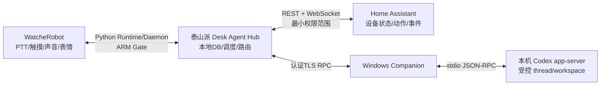

# Desk Agent R1 技术可行性总评与任务分解

> 汇总日期：2026-10-11。根据 [硬件与 SDK 可行性](hardware_feasibility.md)、[Codex 与语音可行性](codex_voice_feasibility.md)、[HA/智能家居与提醒陪伴可行性](ha_services_feasibility.md) 整理。只做资料归纳，不访问设备/在线 HA、不安装、不改代码。本总评不自动更新产品设计稿。

## 总评

**总体有条件可行，但尚无目标整机端到端 PoC。** 推荐先验证 WatcheRobot Python Runtime 在泰山派 ARM64 的可运行性，再将机器人作为语音/交互端、泰山派独立 Hub 作为提醒及家居服务中枢、Windows Companion 作为本机 Codex 执行端。HA 继续作为家居实体、状态和服务的唯一执行接口，尽量不改现有集成。

接口层面已具备按键/触摸说话所需的麦克风 PCM API、PCM 短句播放与 stop、受限表情/输入/运动接口；HA 有状态、服务、事件 API；Codex app-server/SDK 有 thread/turn 生命周期和 Windows 本机执行路线。它们分别是公开源码/协议证据。尚无 Runtime 在泰山派的运行证据、机器人固件 capability 读数、Windows Companion/app-server 集成测试、HA 真实状态回读、提醒持久化/准点播报或完整语音家居/Codex闭环证据。

语音服务可在 Hub 或 Companion 外围运行；ASR/TTS/LLM 供应商和数据路径未定。首版无需强制把 TClaw 集成进 WatcheRobot 固件。PC 关机时，Codex 新任务不可执行；提醒和已配置 HA 通知应继续由泰山派 Hub 服务。

## 资产事实：wiki 历史记录与当前未知

|资产|资料库/源码记录|当前状态与限制|
|---|---|---|
|泰山派常驻主机|wiki 的泰山派项目记录 RK3566、2GB RAM/16GB eMMC、Armbian/Debian、Docker/HA Container；有 `/config` 持久挂载、重启策略、资源快照与巡检页面|这些是资料库记录，不是本轮现场探测。当前系统版本、CPU 架构、Docker 配置、HA 安装类型、资源余量、备份和 RTC 均待只读核验|
|小米/Tuya/Matter|wiki HA 案例中描述小米设备、Tuya 插座/红外设备、Matter 灯及自动化；用户说明现有小米/Tuya 设备集中 HA|当前型号、数量、集成 domain/version、HA entity/service、真实反馈质量、WAN/LAN依赖未知；不能据 wiki 案例断定拥有/仍在使用某设备|
|小米本地网关|Xiaomi Home 官方 README 支持中央网关固件 ≥ `3.3.0_0023` 或内建中央网关软件 ≥ `0.8.9` 的本地 MQTT；无符合条件的网关时控制走云；LAN control 仅部分 IP 设备且官方不推荐|wiki/R1资料未确认当前网关型号、固件/软件、是否存在内建网关或本地模式；作为待盘点的本地化机会，不作为当前事实|
|机器人|用户资料 DOCX 与 SDK 文档描述 ESP32-S3、8MB PSRAM、实体 Flash 标称32MB（示例工程配置16MB）、STM32、HX6538 JPEG、LCD、板载麦克风/扬声器|Xepanda/wiki 没有 WatcheRobot 专属硬件记录。exact SKU/PCB、flash 分区、固件版本、相机/麦克风/显示型号、供电、RTC、隐私硬件和云台行程均未由目标设备确认|
|Windows/Codex|Codex 官方支持 Windows CLI/桌面；调研环境的 CLI 帮助识别 app-server，版本记录 `0.159.2`|非 app-server 初始化/登录/thread/审批或 Companion PoC。app-server 被官方标为 experimental；桌面当前活跃聊天接管无官方保证|
|新增硬件候选|wiki 有 Kindle Wi-Fi/SSH 工具及 4.2 寸多色墨水屏渲染管线记录|未证明墨水屏已接入 R1 或部署在当前泰山派；仅作为后续只读提醒副屏候选|

## 方案建议与备选

### 主路线：Python Runtime + 独立 Hub + Windows Companion + HA Connector

1. **优先 Gate ①：Runtime ARM。** WatcheRobot Python SDK 要 Python 3.10–3.12；其 README 首次 BLE 配网说明 Windows/macOS；公开资料没有 Linux ARM 上完整 Runtime/Daemon 支持矩阵。泰山派 wiki 环境是 Debian 13/Docker，因此需准备兼容 Python 3.10–3.12 的隔离运行环境/容器并核验 ARM64 PyAV wheel、依赖加载、Daemon、BLE/已配对重连。此版本差异要求环境适配和验证，不等于不可部署。
2. **优先 Gate ②：音频录放与打断。** 在 Runtime ARM gate 通过后，以单一 owner 验证 PTT 采集、PCM 播报、播报中 stop/用户打断、完成状态和录播切换；未通过则先用按键 stop/半双工交互，不宣称可插话或全双工。
3. **优先 Gate ③：相机重复 JPEG 吞吐。** Python camera API 提供单帧 JPEG，不是视频协议。尽早测试串行 repeated capture 的帧间隔、画面年龄、资源峰值和关闭后的采集停止时间，为是否开发 Camera LAN Adapter 做决策；不承诺 FPS 或视频规格。
4. 机器人 SDK 的单一 Runtime/Daemon 持有设备连接；PTT 麦克风 PCM、短句 PCM 播放/停止、touch/roller、表达式统一经 Robot Adapter，禁止另建第二条设备连接。
5. 泰山派运行独立 Hub 服务，与 HA Container 分离。Hub 持久化提醒/闹钟/备忘和 occurrence；SQLite 事务提交后再确认保存。调度器从 DB 恢复，不依赖内存 timer；重启、断网恢复按幂等和错过策略处理。HA 凭据只保存在 Hub，实体/服务 allowlist 约束调用。
6. HA Connector 用 WebSocket 读取快照和订阅状态变化，重连后重读快照；REST/WS 调用结果与设备状态确认分开。HA 不可达时不执行、不重放过期控制；服务回执不能播报成物理动作完成。
7. Windows Companion 本机启动 `codex app-server` stdio 子进程，接收由 Hub 经认证 TLS 通道转发的用户意图，使用显式登记工作区和受控 thread。审批绑定具体请求；不暴露 app-server 网络 listener，不假设可接管桌面当前活跃聊天。
8. 首轮仅用 PTT/按键或明确的手动聆听入口。板载麦克风接口存在不代表唤醒词、VAD/AEC、远场、全双工或播报时插话体验已具备；不承诺免唤醒或全双工。机器人音频、运动、相机有单一资源 owner。

### Runtime ARM gate 失败时的降级路线

- **仍满足 PC 关机时提醒与机器人播报：** Hub/调度器放在泰山派或另一台已确认常开的主机。若 Robot Runtime 在泰山派 ARM 失败，不能推定任意 ARM/Linux 主机可解决；候选宿主须由官方支持矩阵明确支持其 OS/架构，或先在目标宿主 PoC 通过 Runtime/Daemon、配对与重连。若没有这种可验证常驻宿主，则选嵌入式 Adapter 或暂缓机器人在线语音。仅把 Hub 放到 Windows 临时主机不能满足 PC 关机后提醒，也不能保证机器人到期播报。
- **嵌入式 Adapter 备选：** 用 WatcheRobot Embedded SDK 独立工程采集 PCM/播放并经受控 LAN 协议连接 Hub；需新增编码、认证、配对、重连和缓冲层。它只替代机器人 Runtime/音频适配，不替代 Hub 持久存储；Hub 仍要留在泰山派或另一常驻主机。
- **仅临时开发演示：** Hub/语音服务可放 Windows PC，但 PC 关机或休眠后提醒调度中断。这不能满足“PC可关机、Edge继续调度”的目标，须明确作为限制。
- 当前 WatcheRobot Embedded SDK commit `646a977bfd76a8516ae505fda2331b81e1049b87` 目标 ESP-IDF 6.0.2，而 V1.0 规格/当前 TuyaOpen 路线提到 IDF 5.4 与 LVGL 8/9差异。此为**只有实施固件移植路线时才需处理的兼容项**：独立工程核验 SDK component、驱动、partition 与 LVGL API，再决定迁移/适配。它不是 Python Runtime/Hub 主路线的阻塞，也不要求升级整个工程。

## 风险分类

|分类|事项|处理方式|
|---|---|---|
|已知适配冲突/差异|Python SDK支持 Python 3.10–3.12；wiki描述 Debian 13。|提供隔离解释器/容器和 ARM64 wheels/Daemon PoC；不是“不兼容即不可部署”的结论|
|已知适配冲突/差异，仅固件路线|Embedded SDK 目标 IDF 6.0.2 vs 现有规格 IDF 5.4；LVGL 8/9接口差异；实体Flash报告32MB vs 工程示例16MB。|只有选择固件集成才按固定 SDK commit 核查。必须读取真实分区表和可恢复镜像；不可直接覆盖/全局升级|
|运行时未知|Runtime/Daemon ARM64、PyAV解码、固件 microphone/audio.stream/camera/motion capability、重连、资源峰值、声学和实际 stop。|先做 W0/W1 gate，依照失败条件选替代主机或嵌入式 Adapter；不将接口存在称作运行通过|
|运行时未知|Codex stdio 握手/认证沿用、thread/turn审批恢复；HA现场集成与状态反馈；Reminder DB/断电/备份。|各做独立 PoC，按任务状态和真实状态回读验收|
|当前真实阻塞（限制端到端验收）|未有 W0 目标设备基线，也未通过 W1 Runtime ARM、音频录放/打断、相机吞吐三项优先 Gate。|Robot E2E 与摄像头能力目前不能验收/宣称已交付；尚无证据表明整条路线不可实现。ASR/TTS隐私、提醒规则等产品决策确定前，相应服务也不能定稿|
|明确真实限制|Codex app-server/WS 当前文档标 experimental；外部控制当前桌面活跃会话未得到官方保证。|首版仅 Companion 自建受控 thread，锁定 CLI/schema版本；桌面会话互通单独 Gate|
|明确真实限制|snapshot API 是 JPEG 单帧，不是视频协议；重复 JPEG 拉取是否满足直播体验未测。|用“新鲜 JPEG 预览”描述，先测吞吐/画面年龄/关闭；不承诺 FPS 或视频规格|
|运行时未知/安全边界|机器人原生配对与媒体/设备通道是否使用 TLS 或等效加密未知。Edge-PC 新通道目标认证 TLS 不代表设备原生链路已有 TLS。|核实 SDK/协议实现；未证明前仅按受信隔离 LAN PoC 评估，不能宣称原生媒体链路已加密|
|明确真实限制|SDK 未提供默认 ASR/LLM/TTS 产品服务；WS 语音/服务调用不能自动视为离线可用；无 RTC/备用供电证据。|选定语音数据边界；先半双工 PTT；断电准点和离线语音不承诺|

## 新能力候选（不自动纳入 R1 核心）

|候选|现有基础与支持条件|边界/状态|
|---|---|---|
|触摸/滚轮停止或贪睡|Python SDK 可接收 backtouch/screentouch/roller；先验证目标固件 capability 与事件稳定性，映射到有限白名单动作|适合提醒 UX 扩展；目标板输入未实测。停止响铃不自动标记事项完成|
|PCM 播放时钟嘴形|SDK 可在设备成功播放 PCM 时用播放时钟驱动程序化嘴形，要求固件支持 `expression.audio_follow.v1`|不是音素同步，也不证明播放链路已通；属于表现增强，不是语音识别证据|
|设备侧 face tracking|Python `face_tracking.open_preview()`可读 JPEG 预览/遥测；需兼容固件 capability 和可用模型|不是身份识别/情绪判断；设备是否有模型未知。先测相机 owner 与云台副作用；与实时查看页面相机/云台独占冲突，不能并行假设|
|HA 事件主动提醒|HA WebSocket `state_changed`/event 订阅和自动化现有；按现场真实 entity、允许范围、去重和勿扰策略接入|实体库存/事件可靠性需首配盘点；先从单一、低风险事件试点|
|小米网关本地化|Xiaomi Home 官方支持满足版本条件的中央网关 MQTT；Tuya/小米数据路径按具体集成核对|网关现状未知，不推断已拥有；只作为减少云依赖的调查/Poc，不做 R1 前置条件|
|墨水屏只读副屏|wiki 有 Kindle 项目和 4.2 寸多色 EPD 渲染资料，可显示今日/近期提醒摘要|未证实硬件已集成；低频只读扩展，不承担即时响铃、删除/确认或实时状态源|
|HX6538 模型推理|Embedded Camera HAL/SSCMA 有模型状态/推理入口；Python vision API 可查询后端/模型并按 `model_id` 启动推理|仅列研究候选；现有模型、精度、适配镜像、工具链和目标设备部署均未核验，不作为新功能承诺或 R1 依赖|

## 开发任务分解与依赖

建议先做 W0 与 W1；W1 是主要路径决策门。通过后按依赖推进。W2（语音链路的 ASR/TTS 选型）、W3（Windows Companion/app-server）和 W4（HA Connector）可在共同消息协议/安全边界明确后并行开发；W5 等 W2–W4 的适配稳定再组合。摄像头 W6 可作为独立分支；W7 动作/嘴形需音频 owner 与设备能力；W8 汇总前序功能做恢复/长稳。

|任务|依赖/可并行|具体产出|验收条件|
|---|---|---|---|
|**W0 资产与现场基线**|先做；用户提供/许可本机只读检查。与外部实现准备可并行|资产表：Robot SKU/PCB/firmware/SDK capability、MCU/Himax版本、flash分区与恢复证据、泰山派 OS/arch/HA install type/容器与资源、设备集成/实体清单、Windows/CLI版本；不采集密钥|未知字段写 `unknown`；wiki 史料与现场现状分列；不将设备案例当硬件库存；检查不修改设备或配置|
|**W1 Runtime ARM + 三项优先 Gate**|依赖 W0 中可获得的软件/设备基线；路线首要 Gate|先验证 Python 3.10–3.12隔离环境、ARM64 PyAV、Runtime/Daemon、配对重连；同轮测 PTT录音→PCM播放→stop/打断；串行重复 camera capture 记录帧间隔/资源/关闭指标；核查 Robot 原生媒体通道认证/加密机制|分项报告 ABI/wheel/Daemon/capability；16k mono PCM与 decode/drop 统计；可听播报、stop/打断状态；snapshot 吞吐与停止；原生配对/媒体认证证据或明确未知。Edge-PC TLS 不计作 Robot 原生链路证据|
|**W2 语音处理与语义路由**|W1 音频原始格式/链路通过后；ASR/TTS供应商决定可并行准备|PTT状态机、ASR文本/置信度、Router意图结构、HA/Reminder/Codex分发边界、短句TTS、取消/静音分离|普通话、设备名/项目名固定语料可复现；歧义先澄清；不假定唤醒词/VAD/AEC/全双工；断WAN给准确不可用状态，不伪造离线应答|
|**W3 Windows Companion/Codex**|不依赖 HA；可与 W2/W4 在共用协议定型后并行|Windows Companion启动 app-server stdio；受控 workspace alias/thread/task map；事件流、审批请求绑定、interrupt/resume、PC↔Hub认证通道|受控 thread 新建/续轮/取消/恢复通过；审批只对绑定 request 生效；重启不重复 turn；不暴露 app-server WS，不声称控制桌面当前活跃聊天；版本/权限状态可观测|
|**W4 HA Connector**|依赖 W0 entity/service inventory；可与 W2/W3 并行|只读快照、WebSocket `state_changed`订阅/断线恢复；受限 service allowlist；调用状态核验器；小米网关是否可本地 PoC|外部状态变化能收敛；服务回执与真实实体状态分开；故障不重放命令；网关/设备未知时本地化结论保持未知|
|**W5 Hub 提醒/备忘/主动服务**|Hub 可以先模拟设备开发；完整语音闭环依赖 W2，HA事件通知依赖 W4|泰山派独立常驻 Hub、SQLite schema/事务、提醒 occurrence/scheduler、Note CRUD、outbox/幂等、备份恢复、通知规则/陪伴偏好授权|正常重启/异常重启/容器删建不丢数据、不重复响；事务成功才确认保存；时区/重复/勿扰/missed policy 正确；PC关闭时 Hub 仍运行；断电不承诺准点|
|**W6 Camera/本地查看**|独立于 W2–W5；共享 Camera owner/权限接口。先 Python repeated snapshot|单客户端 LAN latest-JPEG 预览原型、鉴权/租约/关闭与 stale 状态；Python吞吐达不到用户确认门槛时才试 embedded callback|实测帧间隔/画面年龄/端到端时延/关闭采集时延；仅允许本地认证；不落盘/不录像；snapshot 或重复 JPEG 不叫视频流，不先承诺 FPS；privacy/streaming 状态可观察|
|**W7 表情、输入与云台运动**|依赖 W0 capability；触摸/滚轮可与其他任务分开；motion依赖安全基线|统一 expression/audio owner、输入白名单、PCM播放时钟嘴形；若安全条件齐备再加有限 motion preset/stop|表情能力及 PCM 成功播放后再驱动嘴形；stop、DONE/FAULT、位置与真实机械行程、断链状态均通过后才开放动作；摄像头查看期间 motion lock 生效|
|**W8 故障恢复与稳定性**|W2–W5 纵向链路完成；W6/W7 通过则纳入压力组合|WAN/LAN/HA/Hub/Robot/PC 注入故障记录，DB恢复演练，资源高水位、时钟偏差、duplicate/missed report、已知限制|按产品确认的提醒精度/稳定时长验收；建议首轮 72 小时，仅作为项目门槛；PC断电后提醒可继续；重连不重放过期家居动作/任务；保留失败证据，不宣称未覆盖能力通过|

### 执行分组

- **串行门槛：** W0 → W1 →（W1失败则选替代主机或 Embedded Adapter PoC）→ W5 常驻环境决策。
- **可并行：** W2、W3、W4 可以分别开发并以版本化消息 schema 对接；W6 的静态/协议 PoC可单独做，但不应与 W7 云台动作争抢资源；W0资产盘点不等待它们。
- **组合验收：** W5 完成 DB/scheduler 后接入 W2语音与 W4 HA；W7只在音频和安全 gate 通过后集成；W8放最后，避免把单组件成功混同系统稳定。

## 分层验收口径

|证据层|通过能说明什么|不能说明什么|
|---|---|---|
|公开源码/官方文档|API、协议、版本限制或实现机制存在|用户板 capability 存在、服务部署成功、性能达标|
|静态/模拟 PoC|状态机、数据模型、协议实现符合预期|板端音频/运动/摄像头可用，设备真实执行|
|目标板/泰山派单项实测|该硬件/版本/负载下单项工作的日志与观测|完整语音到云/HA/Codex闭环或长期稳定|
|端到端与恢复验收|特定版本、网络、账户和设备组合的闭环及故障行为|所有设备型号、多用户、未来版本及长期可靠性|

尤其不能将：服务回执当设备完成、HA 接入当本地控制、麦克风 API 当远场语音、PCM 播放当TTS、JPEG快照当视频、动作提交当运动完成、Codex turn 完成当代码验收。

## 来源（公开源码采用固定 commit）

- 项目报告：[硬件与 SDK 可行性](hardware_feasibility.md)、[Codex 与语音可行性](codex_voice_feasibility.md)、[HA/智能家居与提醒陪伴可行性](ha_services_feasibility.md)。
- [WatcheRobot Python SDK 固定 commit `8bc13967a06ef073459be47e930ff43ef37ee8fb`](https://github.com/orulink-ai/WatcheRobot_python_sdk/tree/8bc13967a06ef073459be47e930ff43ef37ee8fb)：Python 3.10–3.12、Runtime/Daemon、microphone/audio/inputs/vision/motion API。
- [WatcheRobot Embedded SDK 固定 commit `646a977bfd76a8516ae505fda2331b81e1049b87`](https://github.com/orulink-ai/WatcheRobot-public/tree/646a977bfd76a8516ae505fda2331b81e1049b87)：ESP-IDF 6.0.2、HAL 音频/相机/显示/云台能力与开发预览验证边界。
- [Xepanda/wiki 固定 commit `7e16002af8b30d639c1be8d5711984ae404379c9`](https://github.com/Xepanda/wiki/commit/7e16002af8b30d639c1be8d5711984ae404379c9)：泰山派 Docker/HA、设备案例、Kindle/EPD/Agent 项目记录；不当作当前在线主机或 R1 设备 inventory。
- [Codex app-server 官方文档](https://developers.openai.com/codex/app-server/)、[Codex SDK](https://developers.openai.com/codex/sdk/)、[Windows sandbox](https://learn.chatgpt.com/docs/windows/windows-sandbox)：协议/Windows 路线与 app-server maturity 限制。API schema 和支持成熟度在实施时需按锁定版本复核。
- [HA WebSocket API](https://developers.home-assistant.io/docs/api/websocket/)、[REST API](https://developers.home-assistant.io/docs/api/rest/)、[Conversation API](https://developers.home-assistant.io/docs/intent_conversation_api/)、[安装方式政策](https://www.home-assistant.io/blog/2025/05/22/deprecating-core-and-supervised-installation-methods-and-32-bit-systems/)。
- [Xiaomi Home 官方 README](https://raw.githubusercontent.com/XiaoMi/ha_xiaomi_home/main/README.md)：local mode 中央网关版本与 MQTT、cloud mode 和有限 LAN control；现场网关未知。
- [Home Assistant Tuya 集成](https://www.home-assistant.io/integrations/tuya/)、[Camera entity](https://developers.home-assistant.io/docs/core/entity/camera/)、[HA Camera 集成](https://www.home-assistant.io/integrations/camera/)。
