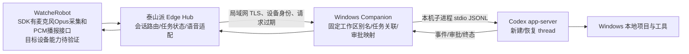

# Desk Agent R1：Codex 与语音任务技术可行性

> 调研日期：2026-10-11。范围：只读核对 OpenAI 官方 Codex/API 文档、本机 Codex CLI 版本与帮助、产品资料，以及 `Xepanda/wiki` 已有 Agent 终端平台资料。本文只证明公开接口/文档和本机 CLI 帮助所述能力；没有安装、改代码、启动服务、读取凭证或访问设备。**没有机器人、泰山派或 Windows Companion 的硬件/端到端 PoC 证据。**

## 结论

用户设想的链路**有条件可行，建议以 Windows Companion + 本机 Codex app-server 为执行核心，Edge Hub 做路由和状态中继，机器人只做语音输入/播报与有限交互**。Codex 官方公开协议覆盖了新建/恢复 thread、追加进行中任务、取消、流式事件、命令/文件审批；Windows 原生 Codex CLI 和桌面应用有官方支持。真正的桌面文件访问发生在 Windows Companion 启动的本机 Codex 进程中，Edge/机器人不应直接接触项目目录或 Codex 凭证。

三个边界决定了目前只能评为“协议可行、集成待 PoC”：

1. **接续普通 Codex 桌面当前打开的聊天没有得到官方保证。** app-server 可列举/恢复它能访问的已保存 thread，SDK 可按 thread ID 恢复；官方文档没有承诺外部 Companion 能发现并接管某个已打开的 Windows 桌面聊天，也未承诺两客户端并发操作时的行为。首版应自己创建并保存受控 thread；桌面活跃聊天接管列为单独 Gate。
2. **app-server 当前官方文档仍有非生产警告。** 官方原句：“The app-server command and WebSocket transport are experimental and aren’t supported for production workloads.” stdio 是默认传输，适合本机父子进程集成；但本机 CLI `0.159.2` 也将 `codex app-server` 标作 `[experimental]`。因此可做封闭 PoC/受控单用户原型，投产前需确认成熟度、版本稳定性及官方支持边界。远端 WebSocket 不应作为机器人/Edge 到 Codex 的生产直连方式。
3. **SDK 已公开麦克风采集接口，但目标设备的采音与声学体验仍待验证。** 最新 WatcheRobot Python SDK `main` 提供 `robot.microphone.open_pcm()` 和 `record_pcm()`：设备 Opus 上行可解码为 16 kHz、单声道、s16le PCM，也可录成 WAV。该代码/文档证据不证明目标固件声明麦克风能力、Daemon/Linux ARM部署可用，亦不证明 AEC、唤醒词、VAD、全双工或播放中打断。没有目标板实测就不能宣称“直接说话可用”。

建议先实现“受控新 thread + 选定工作区 + 语音提交/结果播报 + 追加/取消/恢复 + 审批往返”纵向 PoC。默认不要让 TClaw 或语音模型直接执行任意 shell 命令；所有 Codex 工具与项目访问继续由本机 Codex 权限/审批策略控制。

## Codex 官方接口核验

| 能力 | 官方资料支持 | 对 R1 的含义 / 限制 |
|---|---|---|
| Codex SDK | TypeScript `@openai/codex-sdk` 可 start、continue、按 thread ID resume 本地 thread；Node.js 18+。SDK 指向自动化任务；深度客户端集成推荐 app-server。Python SDK 文档称稳定发行并以本机 app-server 为控制面。 | 新任务与同线程续轮可用。较简单的异步“提交后取最终答复”适合 SDK；需要实时事件、审批、取消、审批UI与恢复流程时 app-server 更匹配。具体版本/Windows环境需 PoC。 |
| app-server thread/turn | JSON-RPC over JSONL stdio。`thread/start`、`thread/list`、`thread/read`、`thread/resume`、`turn/start`、`turn/steer`、`turn/interrupt` 均有文档；事件包含 `item/started`、`item/completed`、`item/agentMessage/delta`、`turn/completed`。 | 用 Edge `task_id` 关联 `workspace_id/thread_id/turn_id`。新用户补充可对活动 turn 调 `turn/steer`；活动 turn 取消用 `turn/interrupt`，等 `turn/completed` 的 `interrupted` 终态后再播报。已结束后继续则恢复 thread 再开新 turn。重启恢复与事件对账仍须 PoC。 |
| 审批 | 命令执行、文件变更、权限请求可由 app-server 以服务端 JSON-RPC 请求交给客户端，客户端需对具体请求响应；审批项携带 thread/turn/item 标识。 | Edge/机器人需展示实际命令或变更与精确请求，用户批准/拒绝回传必须绑定 request/item ID、及时失效；语音“好”不能成为跨任务的通用授权。不要自动接受审批。 |
| 终态和结果 | `turn/completed` 状态可为 completed/failed/interrupted；`item/completed` 是 item 最终状态。错误事件会包含错误类别，有时有上游 HTTP 状态。 | 播报模型最终答复与任务终态；“已完成”不等于实现验收通过。是否修复要额外看 diff、命令 exit code、测试与用户验收。 |
| 桌面现有聊天 | `thread/list` 可按页返回存储的 thread；`thread/resume` 可恢复一个已保存 ID。SDK 同样允许调用 `resumeThread(threadId)`。 | **未发现官方契约承诺能从外部发现/控制“Windows 桌面当前活跃聊天”。** app-server 的 thread list 是 Codex 本地存储 thread 列表，不等同于对桌面 UI 的控制协议。若共用 `CODEX_HOME`/会话存储，是否可列出并恢复桌面创建的目标 thread、是否冲突，都必须实机 PoC；未经验证只支持 Companion 自建 thread。 |
| 远程访问 | 官方将 WebSocket transport 标为 experimental/unsupported；非 loopback listener 在 rollout 阶段默认可能没有认证，文档要求配置 WebSocket auth，远程要 TLS。 | Companion 在 Windows 本机启动 `codex app-server --listen stdio://`，不暴露端口。Edge-PC 之间另建经过身份认证的 TLS 通道；不要将 stdio JSON-RPC 直接暴露到 LAN，也不把 app-server WS 当公网接口。 |
| Windows | 官方支持 Codex Windows 桌面应用、CLI、PowerShell 与原生 Windows sandbox；WSL 是可选路线。app-server 文档含 Windows sandbox setup API。 | 目标路径可留在用户 Windows 工程目录，避免先把项目迁移到 Linux/TClaw。需在当前 Windows 主机核验子进程启动、路径、sandbox/审批、系统休眠/重启与升级。 |

### 本机只读核对

- `codex --version` 返回 `codex-cli 0.159.2`。
- `codex app-server --help` 返回 `[experimental] Run the app server or related tooling`，默认 `stdio://`，并列出 `ws://`、Unix socket、`off` 以及 WS 认证参数。
- 这是 CLI 安装/命令帮助证据，不是 app-server 初始化、登录、读取项目、thread/turn、审批、打断或 Windows sandbox 的集成测试。没有运行 app-server。
- 未检查登录态或认证缓存；没有读取 `auth.json`、密钥、环境变量凭证或浏览器会话。

## 认证、授权与费用类别

### 可选路径

1. **沿用本机 Codex CLI 登录。** OpenAI 官方认证说明称 Codex 桌面应用、CLI、IDE extension 的登录信息可缓存复用；CLI 与扩展共享缓存。app-server 子进程可能使用同一用户环境，但产品实现是否能无缝继承当前桌面登录需要验证。不能把“共用认证”说成“共享聊天历史”。
2. **独立接入 ChatGPT plan usage。** 官方 app-server 的 Sign in with ChatGPT 示例要求集成方获取 ChatGPT OAuth access token、以受限 Responses provider 启动 app-server，并自行处理 token refresh；成功推理才证明该次账户有权限。它需要应用自己的 OAuth/注册和凭证生命周期，不能偷读桌面应用的登录文件。官方开放式登录流程还明确指出，身份认证本身不自动授予计划用量权限。
3. **OpenAI API key。** Codex CLI/SDK 可用 API key 做自动化；按 API 账户的模型及音频调用计费。API key 方案和 ChatGPT 订阅内 Codex 用量是两种计费路径，不能用 API token 单价估算订阅额度。

### 费用拆分

- **Codex 执行**：ChatGPT plan/额度或 API key 计费，取决于选定认证模式、账户资格、模型与额度；Codex 指令中的使用/额度与 OpenAI API 单价彼此独立。不要在实现里写死今天的套餐价。
- **语音输入与输出**：如使用 OpenAI API，转写、Realtime 或 GPT-Live、TTS、后端模型/工具费用按相应产品的用量口径分别计；Realtime 对话按各轮音频/文本 token 及 ASR 等配置计，GPT-Live 语音会话与后端模型和工具费用分开。实际价格、地区、可用性随官方价格页变化，PoC 时从价格页与 Usage 记录校准，不在本报告推算总价。
- **本地开源 ASR/TTS/VAD**：没有逐次云 API 费用，但有泰山派/PC CPU/内存、模型存储、维护、功耗、中文质量和许可证/分发成本；目前没有本项目基准测试。
- **Tuya/TClaw**：公开 README 描述 TuyaOpen key / device-cloud agent 路径，不足以推断本账号计价、模型额度或家庭设备 API 权限，须以目标服务与账号套餐核价。

## 已有系统是否能复用

公开 `Xepanda/wiki` 文档记录已有 **Linux VM 上 Herdr + Collie + Tailscale/Cloudflare** 终端访问体系：Herdr 管独立 PTY/工作区，Collie 是浏览器终端入口，面向其配置的终端进程。文档明确普通终端中已有进程不会自动迁入 Herdr，也没有把手机/浏览器接入描述成 Windows 桌面 Codex 聊天控制 API。它可以复用配对、终端隔离、状态展示的产品经验；当前不是用户所说 Windows 项目工作区的执行桥。

另一个现成候选是 TClaw 内部 `OpenClaw Ctrl` gateway 控制工具，但公开资料只证明其设计用于 OpenClaw Gateway / TClaw 设备 Agent 整合，没有证明有可直接控制 Windows Codex app-server、接续桌面聊天或承载 R1 机器人音频的适配器。不要再新建一套泛化终端/agent平台；需要的是一个窄的 Windows Codex Companion 适配器和 Edge 路由契约。可先读测现有 Herdr/Collie 的协议/认证来判断是否能作 Companion 的安全传输层，但不能把它当作 Codex 的 thread/turn 协议。

## 建议架构

- **机器人**：最新 Python SDK `main` 有 `MicrophoneDomain.open_pcm()`/`record_pcm()`；设备上传 Opus，Application API提供解码后 16 kHz mono s16le PCM，`record_pcm()` 可录成 WAV，依赖 PyAV。SDK同时有有限 PCM 播放/stop接口。目标固件是否提供匹配 microphone capability、目标 daemon是否能正常转发/解码、采音与播报能否并行仍未实测；VAD/mic mute、AEC、唤醒和打断效果也未知。播报收到打断后须调用真实 stop 并确认设备播放状态。
- **Edge Hub**：保留单用户任务数据库与事件序号，持久化 `task_id, workspace_alias, thread_id, active_turn_id, state, last_event_seq, created_at, updated_at, result_ref`；自然语音经 ASR 后先做确定性意图分类，要求用户确认工作区和目标摘要，再发任务。边缘层不保存 Codex 登录 token，不接受语音构造 shell 指令。
- **Windows Companion**：常驻用户级服务；用户手动配置一个只读可见的工作区别名表和对应绝对路径，拒绝语音拼路径。它启动 app-server 子进程并通过 stdin/stdout JSONL 协议操作，使用保存的 thread ID 做恢复。PC Companion 保管本机 Codex 认证/工作区权限；需在用户当前 Codex 权限策略下执行。建议 Companion 主动连接 Edge Hub，Edge 不直连 app-server 端口。
- **控制协议**：Edge → Companion 使用本产品版本化、限操作的 RPC。任务正文、追加、取消、resume/list、确认请求均有 request ID、task ID、线程/轮次 ID、事件序号和过期时间；幂等提交并在断线后查询真实 Codex 状态。禁止任意 shell/RPC 转发，权限提示必须回到实际 Codex 审批状态。
- **线程策略**：首版由 Companion 创建受控 thread，thread ID 由 Edge task 映射保管；同 thread 的后续自然语言可追加为新 turn。活动 turn 用 `turn/steer`，取消用 `turn/interrupt`。用户说“继续/恢复”时需结合状态解释是恢复断线的 session 还是中断后在原 thread 开新 turn，避免把状态 unknown 当作可重复执行。
- **用户反馈**：播报“已接收/处理中/等待确认/已中断/失败/本轮完成”区分清楚。完成通知带摘要并说明证据等级；长输出、diff、完整审批内容在 Companion/Edge 页面展示。语音助手“解释 Codex 输出”属于语音层回答，不能自动重新给 Codex 下指令。

## ASR、TTS、VAD、AEC 与打断路线

| 路线 | 优点/公开接口证据 | R1 限制与待验 |
|---|---|---|
| 云端语音代理（OpenAI Realtime 或 GPT-Live 等） | 官方支持 WebSocket/WebRTC、VAD 事件、工具/对话事件；Realtime 文档说明检测到 speech started 时可取消模型响应，客户端要停本地播放并截去未播音频。低延迟语音体验可作为云端候选。 | 机器人/Edge 采集到的音频怎样进入会话仍需适配；其语音模型不是 Codex app-server thread 控制API，建议只交给语音理解/对话，任务操作仍走 Companion 的受控 RPC。云依赖、音频隐私、网络中断与用量都要明确；实时转写文本可能与模型真实理解不完全一致。 |
| 级联式云 ASR → 意图/路由 → Codex/其他服务 → TTS | 可审计：ASR 文本可先回显/确认；Codex app-server独立保存代码会话；TTS只负责播报。适合 R1 语音先清晰可控、延迟可接受的纵向 PoC。 | 多阶段延迟较高；每家服务分开计费；VAD/AEC/回声打断需自行组合。不要让对话模型把自由文本直接拼成 shell 命令。 |
| 泰山派/本地开源语音（whisper.cpp + Piper 等） | Whisper.cpp 提供 C/C++ Whisper 本地推理实现；Piper 是本地神经 TTS 候选；VAD 可评估 Silero VAD 或 WebRTC VAD。可减少原始音频离开家庭网络，断 WAN 时仍可能完成本地 ASR/TTS。 | 泰山派型号、NPU/CPU/内存、音频驱动、中文模型、实时率、TTS 音色与维护成本没有本项目实测。VAD 不等于唤醒词或 AEC。需锁模型/许可证/版本并测热稳态。 |
| Tuya TClaw/Tuya AI | TClaw 官方仓库称支持 Raspberry Pi/Linux ARM、Ubuntu x64 及部分 T5AI/ESP32 板，提供 device-cloud AI、IM channel、Cron/skills 与部分板语音 ASR。可作为单独边缘Agent或 Tuya 服务 PoC。 | 项目 README 标注 active development；它不自动适配 WatcheRobot Python Runtime，也没有公开证据证明支持本项目的 Windows Codex 桌面线程操作。TClaw Linux EXEC 工具属于可执行 shell 的高权限能力，必须关闭或严格沙箱，不能让语音任务直达。Tuya key/账号权限和实际计价未核。 |

**VAD/AEC/全双工结论：** VAD 用于判断语音开始/结束；AEC 用扬声器参考信号与麦克风输入抵消回声；两者不可互相替代。SDK 已有 mic capture，但目标固件能力和数据通路尚未验证，且 SDK/硬件资料没有证明 AEC。先确认设备/固件提供的声学前端、回声参考与控制接口；若没有，评估能否把麦克风和扬声器参考都送到 Edge 做 AEC。扬声器播报时必须继续可检测用户插话，正确流程是 VAD/start → 立即停播 → 发语音模型 response.cancel → 截断尚未播放的语音上下文；Codex任务中断单独发 `turn/interrupt`，不能混淆语音打断和任务取消。

## 置信边界与主要阻塞

| 判断 | 置信度 | 边界/阻塞 |
|---|---|---|
| app-server 官方设计可做定制 Codex 客户端 | 高（文档证据） | app-server CLI 当前实验性/有非生产警告；协议版本与 Windows 集成需锁定后测试。 |
| 追加、取消、恢复已保存的 Companion thread | 高（协议能力） | `turn/steer` 只在活动 turn 有效；取消是请求中断而非立即成功；断线或进程崩溃时的 in-flight turn reconcile 要 PoC。 |
| 复用 Windows 当前桌面活跃聊天 | 低/未知 | 未发现公开契约/证据；需检查桌面 app 生成 thread 是否同一可见存储并测试同时打开/恢复。否则首版必须新建专用 thread。 |
| Windows 本地项目执行 | 中高（产品支持+CLI存在） | 当前 CLI help 有 Windows sandbox 相关接口，但 Companion 子进程继承策略、沙箱授权、路径选取未验证。 |
| 机器人对话语音闭环 | 中（SDK接口已证实，硬件闭环未证实） | Python SDK `open_pcm()`/`record_pcm()` 存在；固件 capability、泰山派 Daemon采音与解码、AEC、唤醒、ASR前端、全双工播放中采集和目标板 PCM 播放均未测。 |
| TClaw 替代/复用为 Windows Codex bridge | 低 | 源码公开显示其更偏设备/云 Agent 与 IM/MCP；没有 Codex desktop integration 证据。可只作语音服务/边缘Agent横向比较，不能替代 Companion。 |
| 费用 | 类别清楚、金额需刷新 | ChatGPT plan 用量和 API token/音频计费分离；模型、组织额度、地区和套餐时变。获取用量记录之前不估算月费。 |

**硬件/运行证明明确缺失：** 没有在泰山派部署 TClaw、ASR/TTS 或 Edge Hub；没有 WatcheRobot 摄音/播放测试；没有 Windows Companion 实际创建或恢复 Codex thread；没有任务改文件、运行命令、审批、取消、重启恢复或机器人播报端到端证据。本文及源码/SDK文档不得写成“硬件跑通”。

## 最小端到端验收（后续 PoC）

1. **基线与授权**：记录 Windows/CLI/app-server 版本、登录类型、工作区绝对路径、当前 git 状态和 sandbox/approval 设置；只配置一个明确 alias。不要把认证 token 放入日志。验收：机器人只能请求该 alias；没有 alias 或 Companion 离线时不执行，显示明确状态。
2. **新建真实任务**：对机器人讲话，ASR 转写/识别项目和目标；需要歧义澄清时先问；用户确认后 Companion 创建 thread 并让 Codex 只读检查选定工作区。验收：关联 task/thread/turn ID，事件流和最终文本正确回到 Edge/机器人；不声称代码修好了。
3. **修改与证据**：在用户批准范围内要求 Codex 做一个小、可逆的实际项目变更，运行用户指定的检查。验收：diff 和命令退出码可从 Companion/Edge 查看；语音总结与文件证据一致；失败如实播报。
4. **追加/取消/恢复**：活动时追加一条明确补充，确认 steer 到同一 turn；取消并等 interrupted 终态；同 thread 发新 turn 继续。重启 Companion 后恢复已保存 thread 并对账，证明不会重复开 turn 或重放旧请求。验收记录每个状态转换及关联 ID。
5. **真实审批往返**：配置一个会触发 Codex 询问的安全场景；机器人/Edge 准确展示待批准项目并回传批准/拒绝。验收只能解除对应请求，拒绝不会执行，重启/过期请求不自动批准。
6. **声学链路**：在目标机器人/实际麦克风上测至少普通话 + 项目名/英文缩写 + 噪音/播放回声；分别测试只听、只播、播报时插话、stop 时延、网络断开。验收语音转写、打断状态和机器人播放完成态来自真实设备日志/观察；无设备数据则明确标阻塞。

本验收的过关只表示给定目标机和版本上的这条 PoC 通过，不推广为任意 Codex 桌面聊天可接管或量产可靠性证明。

## 可安排的开发任务

| 顺序 | 前置依赖 | 产出 | 验收条件 |
|---|---|---|---|
| A. Companion/app-server 机制 PoC（先做） | 确认目标 Windows 用户、Codex 登录选择、一个明确工作区；锁 CLI 版本；不读取桌面凭证 | 本机小型 Companion 原型，stdio启动 app-server，最小 JSON-RPC client，thread/task映射 | 新建 thread、读流式事件、追加、取消、审批 decline/accept、恢复；记录有效协议与 sandbox 行为；不开放网络 listener。桌面现有 thread 是否可恢复做只读可见性测试，明确结论/未知。 |
| B. Edge-PC RPC 与可靠任务状态 | A 的 thread/turn schema 和状态机结果；确定 LAN 配对/TLS方式 | Companion outbound authenticated TLS channel、Edge任务队列/持久化状态、幂等与断线 reconcile | 伪造/过期/重复 request 被拒或去重；重连后 thread/turn真实状态与数据库收敛；没有 shell passthrough。 |
| C. WatcheRobot 音频能力 PoC | 具体机器人固件/SDK版本；最新 SDK capture API 已有文档；确认目标固件 microphone capability、Daemon/Linux ARM依赖（含 PyAV）与音频通道 | 设备采音/解码/短PCM播报/stop与状态观察的最小应用 | 连续采音与播放行为有板上日志；确认 Opus→PCM格式/帧/丢包行为；播报中插话、AEC/mute/stop 延迟实测；缺项列出固件/外置音频方案。 |
| D. 选型 ASR/VAD/AEC/TTS | C 的原始 PCM 格式、带宽/算力信息；隐私和云费用偏好 | 云级联与本地候选对比记录，普通话测试语料和资源基准 | 同一组语料测 ASR 关键词率、端到端延迟/RTF、内存/CPU、TTS首声、误打断/回声；对比云断网行为与费用账单；没有测出的指标留空。 |
| E. 真实任务 E2E 与用户验收 | A–D 通过，限定一个项目、一个账号和审批策略 | 任务/voice UX 集成与可观测审计，进度与结果播报 | 完成上面的 6 项 PoC 验收；任务摘要、diff、命令/测试结果一致；隐私、断网、取消和失败流程均通过后才扩大范围。 |

## 来源

### OpenAI 官方文档

- [Codex App Server](https://developers.openai.com/codex/app-server/)（当前会重定向至 `https://learn.chatgpt.com/docs/app-server`）：接口总览、thread/turn 生命周期、stdio 默认传输、审批、experimental/production 警告。
- [Codex SDK](https://developers.openai.com/codex/sdk/)（重定向至 `https://learn.chatgpt.com/docs/codex-sdk`）：TypeScript/Python SDK 能力、resume、稳定状态。
- [Codex CLI](https://developers.openai.com/codex/cli/)：Windows CLI 及登录流程。
- [Codex CLI command reference](https://learn.chatgpt.com/docs/cli/reference)：app-server maturity 与命令分类。
- [Windows sandbox](https://learn.chatgpt.com/docs/windows/windows-sandbox)：原生 Windows 支持与 sandbox 类型。
- [Authentication](https://learn.chatgpt.com/docs/auth)：CLI、桌面应用与 IDE 的登录缓存边界、API key说明。
- [Codex app-server Sign in with ChatGPT](https://developers.openai.com/siwc/token-sharing-open-source/codex-app-server)：独立 OAuth token 与 Responses provider 方式。
- [Integrating Sign in with ChatGPT in your Open Source App](https://developers.openai.com/cookbook/articles/sign-in-with-chatgpt)：应用注册、ChatGPT 计划用量授权与会话权限边界。
- [Codex pricing](https://developers.openai.com/codex/pricing) 与 [API pricing](https://developers.openai.com/api/docs/pricing)：订阅与 API usage 独立；实时价格应在实施时刷新。
- [Audio and voice](https://developers.openai.com/api/docs/guides/audio)、[Realtime conversations](https://developers.openai.com/api/docs/guides/realtime-conversations)、[Realtime cost optimization](https://developers.openai.com/api/docs/guides/voice-latency-cost)：语音方案、VAD/打断机制与计费类别。

### Tuya 与开源语音候选

- [Tuya TClaw GitHub](https://github.com/tuya/TClaw)：README 描述的支持平台、Agent/IM、设备工具、语音支持板及 active-development 声明。
- [TClaw 官方文档](https://docs.tuyaopen.ai/tclaw)：调研入口；本轮页面抓取工具无法打开此站，因此不以其未读取的细节作依据。
- [whisper.cpp](https://github.com/ggml-org/whisper.cpp)：本地 C/C++ Whisper 推理候选。
- [Piper 新仓库](https://github.com/OHF-Voice/piper1-gpl)：本地神经 TTS 候选。原 `rhasspy/piper` 仓库已归档并指向新仓库；新仓库标 GPL-3.0，须先审许可证和模型授权，再决定是否适合分发。
- [Silero VAD](https://github.com/snakers4/silero-vad)：语音活动检测候选；VAD 不代表 AEC 或唤醒词。
- [WatcheRobot Python SDK `microphone-audio.md`](https://github.com/orulink-ai/WatcheRobot_python_sdk/blob/8bc13967a06ef073459be47e930ff43ef37ee8fb/docs/microphone-audio.md) 与 [`robot.py`](https://github.com/orulink-ai/WatcheRobot_python_sdk/blob/8bc13967a06ef073459be47e930ff43ef37ee8fb/src/watcherobot/robot.py)：当前 main commit `8bc13967a06ef073459be47e930ff43ef37ee8fb`（release 0.1.11，2026-10-10）定义 `MicrophoneDomain.open_pcm()`、`record_pcm()`；device上行为 Opus 16 kHz mono、每包60 ms，PCM API返回16 kHz mono signed-16 little-endian。此源码证据不等于目标固件能力或板上验证。

### 项目资料/源码路径

- `docs/Desk_Agent_R1_产品设计_V2.0_草案.md`：产品定位、场景与系统分工。
- `docs/Desk_Agent_R1_产品设计_V2.1_用户体验草案.md`：Codex 任务语义、语音流程、安全、验收门槛。
- `docs/Desk_Agent_R1_能力与资料核验.md`：SDK 可提供的音频/输入/表情接口和未验证硬件边界。
- `Xepanda/wiki`：[`01-architecture-and-progress.mdx`](https://raw.githubusercontent.com/Xepanda/wiki/master/docs/02-projects/ai-agent-platform/01-architecture-and-progress.mdx)、[`02-linux-deployment.mdx`](https://raw.githubusercontent.com/Xepanda/wiki/master/docs/02-projects/ai-agent-platform/02-linux-deployment.mdx)、[`03-daily-use.mdx`](https://raw.githubusercontent.com/Xepanda/wiki/master/docs/02-projects/ai-agent-platform/03-daily-use.mdx)、[`04-troubleshooting-and-verification.mdx`](https://raw.githubusercontent.com/Xepanda/wiki/master/docs/02-projects/ai-agent-platform/04-troubleshooting-and-verification.mdx)。读取了 GitHub `master` 当前正文；页面记录其 Linux Herdr/Collie 终端边界及验收状态，不代表本轮重新验证线上服务。
